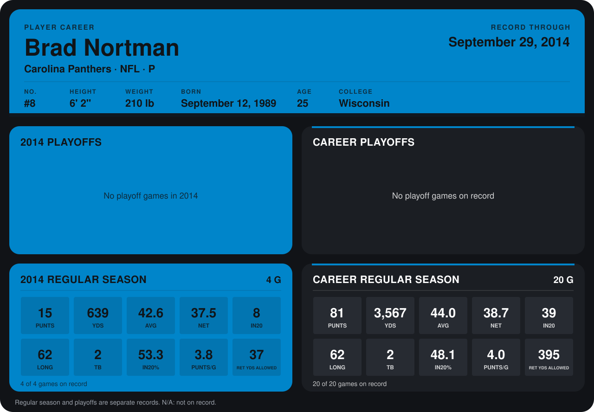

# Brad Nortman

## Career stats

### Regular season

| Season | Team | Age | # | G | PUNTS | YDS | AVG | NET | IN20 | LONG | TB | IN20% | PUNTS/G | RET YDS ALLOWED |
|---|---|---:|---:|---:|---:|---:|---:|---:|---:|---:|---:|---:|---:|---:|
| 2013 | Carolina Panthers | 23 | 8 | 16 | 66 | 2,928 | 44.4 | 38.9 | 31 | 62 | 0 | 47.0 | 4.1 | 358 |
| 2014 | Carolina Panthers | 24 | 8 | 5 | 20 | 887 | 44.4 | 38.6 | 9 | 64 | 3 | 45.0 | 4.0 | 55 |
| **Career** |  |  |  | 21 | 86 | 3,815 | 44.4 | 38.9 | 40 | 64 | 3 | 46.5 | 4.1 | 413 |

### Playoffs

No playoff games on record.

## Awards

None on record.

Age is his age on the league's opening game of each season; # is the number listed for him that season with that team (2014: the card's rule; 2013: the 2013 season roster), N/A where no listing applies.

Records through October 5, 2014. Identity: listed 2014 roster data, Weeks 1-4; number: 2014 Week 1 roster. [All Carolina Panthers players](README.md).
