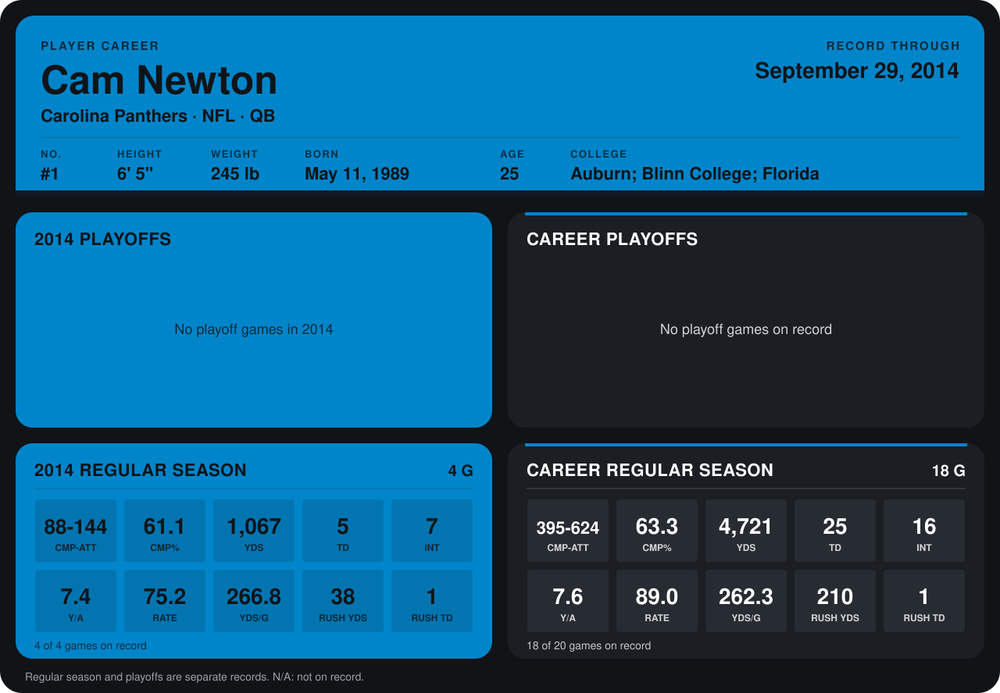

# Cam Newton

## Career stats

### Regular season

| Season | Club | G | CMP-ATT | CMP% | YDS | TD | INT | Y/A | RATE | YDS/G | RUSH YDS | RUSH TD |
|---|---|---:|---:|---:|---:|---:|---:|---:|---:|---:|---:|---:|
| 2013 | Carolina Panthers | 14 | 307-480 | 64.0 | 3,654 | 20 | 9 | 7.6 | 93.2 | 261.0 | 172 | 0 |
| 2014 | Carolina Panthers | 5 | 108-173 | 62.4 | 1,309 | 6 | 7 | 7.6 | 80.3 | 261.8 | 50 | 1 |
| **Career** |  | 19 | 415-653 | 63.6 | 4,963 | 26 | 16 | 7.6 | 89.8 | 261.2 | 222 | 1 |

### Playoffs

No playoff games on record.

## Awards

None on record.

Records through October 5, 2014. Identity: listed 2014 roster data, Weeks 1-4; number: 2014 Week 1 roster. [All Carolina Panthers players](README.md).
