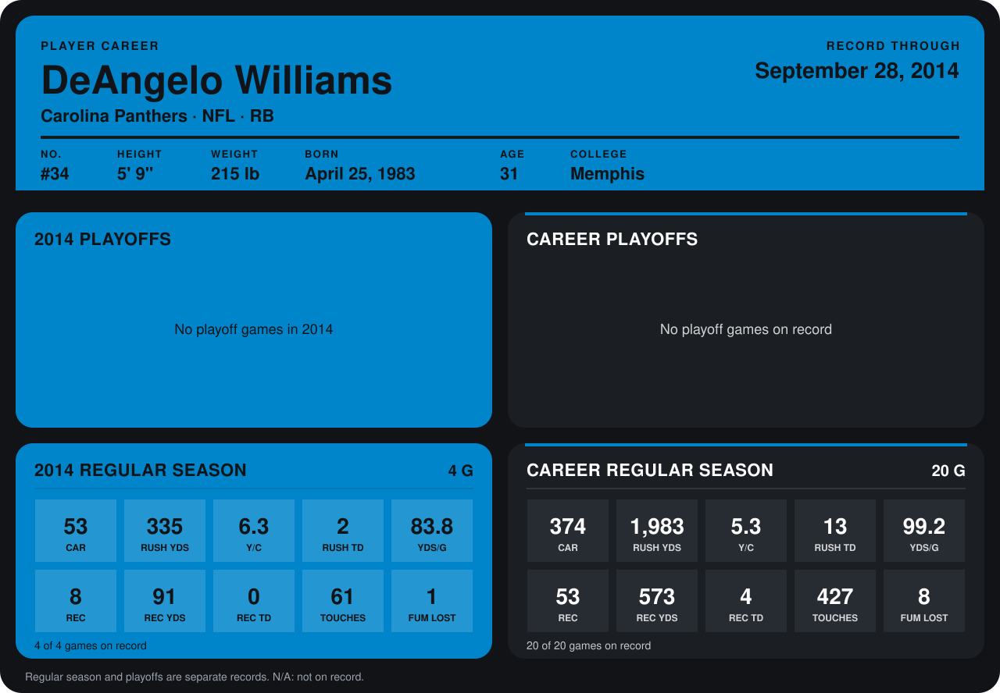

# DeAngelo Williams

## Career stats

### Regular season

| Season | Team | Age | # | G | CAR | RUSH YDS | Y/C | RUSH TD | YDS/G | REC | REC YDS | REC TD | TOUCHES | FUM LOST |
|---|---|---:|---:|---:|---:|---:|---:|---:|---:|---:|---:|---:|---:|---:|
| 2013 | Carolina Panthers | 30 | 34 | 16 | 321 | 1,648 | 5.1 | 11 | 103.0 | 45 | 482 | 4 | 366 | 7 |
| 2014 | Carolina Panthers | 31 | 34 | 4 | 53 | 335 | 6.3 | 2 | 83.8 | 8 | 91 | 0 | 61 | 1 |
| **Career** |  |  |  | 20 | 374 | 1,983 | 5.3 | 13 | 99.2 | 53 | 573 | 4 | 427 | 8 |

### Playoffs

No playoff games on record.

## Awards

- NFC Offensive Player of the Month (2013, November)
- NFC Offensive Player of the Week (2013, Week 17)
- AP Second-Team All-Pro (2013, RB)

Age is his age on the league's opening game of each season; # is the number listed for him that season with that team (2014: the card's rule; 2013: the 2013 season roster), N/A where no listing applies.

Records through September 28, 2014. Identity: listed 2014 roster data, Weeks 1-4; number: 2014 Week 1 roster. [All Carolina Panthers players](README.md).
