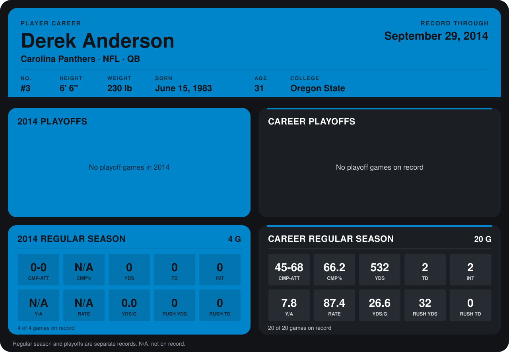

# Derek Anderson

## Career stats

### Regular season

| Season | Club | G | CMP-ATT | CMP% | YDS | TD | INT | Y/A | RATE | YDS/G | RUSH YDS | RUSH TD |
|---|---|---:|---:|---:|---:|---:|---:|---:|---:|---:|---:|---:|
| 2013 | Carolina Panthers | 16 | 45-68 | 66.2 | 532 | 2 | 2 | 7.8 | 87.4 | 33.2 | 32 | 0 |
| 2014 | Carolina Panthers | 4 | 0-0 | N/A | 0 | 0 | 0 | N/A | N/A | 0.0 | 0 | 0 |
| **Career** |  | 20 | 45-68 | 66.2 | 532 | 2 | 2 | 7.8 | 87.4 | 26.6 | 32 | 0 |

### Playoffs

No playoff games on record.

## Awards

None on record.

Records through September 29, 2014. Identity: listed 2014 roster data, Weeks 1-4; number: 2014 Week 1 roster. [All Carolina Panthers players](README.md).
