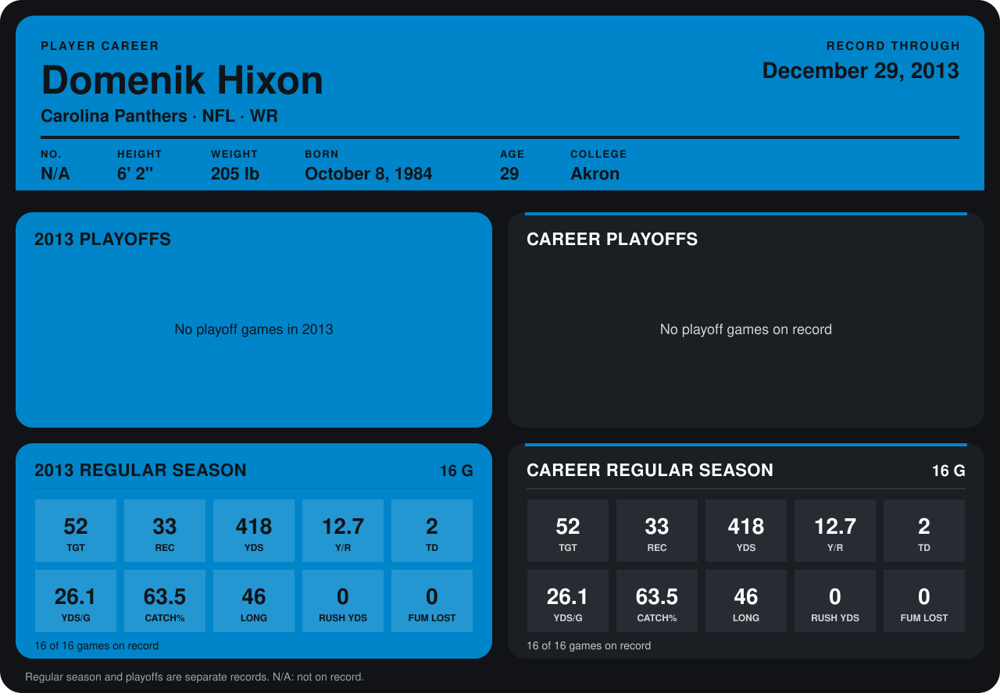

# Domenik Hixon

## Career stats

### Regular season

| Season | Club | G | TGT | REC | YDS | Y/R | TD | YDS/G | CATCH% | LONG | RUSH YDS | FUM LOST |
|---|---|---:|---:|---:|---:|---:|---:|---:|---:|---:|---:|---:|
| 2013 | Carolina Panthers | 16 | 52 | 33 | 418 | 12.7 | 2 | 26.1 | 63.5 | 46 | 0 | 0 |
| **Career** |  | 16 | 52 | 33 | 418 | 12.7 | 2 | 26.1 | 63.5 | 46 | 0 | 0 |

### Playoffs

No playoff games on record.

## Awards

None on record.

Records through December 29, 2013. Identity: his listed 2013 season roster data (no 2014 Weeks 1-4 roster row). [All Carolina Panthers players](README.md).
