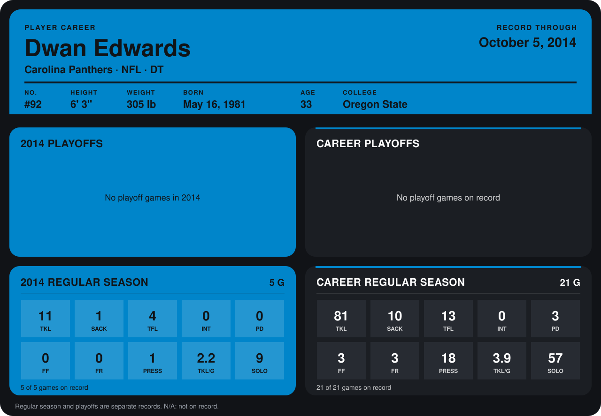

# Dwan Edwards

## Career stats

### Regular season

| Season | Club | G | TKL | SACK | TFL | INT | PD | FF | FR | PRESS | TKL/G | SOLO |
|---|---|---:|---:|---:|---:|---:|---:|---:|---:|---:|---:|---:|
| 2013 | Carolina Panthers | 16 | 70 | 9 | 9 | 0 | 3 | 3 | 3 | 17 | 4.4 | 48 |
| 2014 | Carolina Panthers | 5 | 11 | 1 | 4 | 0 | 0 | 0 | 0 | 1 | 2.2 | 9 |
| **Career** |  | 21 | 81 | 10 | 13 | 0 | 3 | 3 | 3 | 18 | 3.9 | 57 |

### Playoffs

No playoff games on record.

## Awards

None on record.

Records through October 5, 2014. Identity: listed 2014 roster data, Weeks 1-4; number: 2014 Week 1 roster. [All Carolina Panthers players](README.md).
