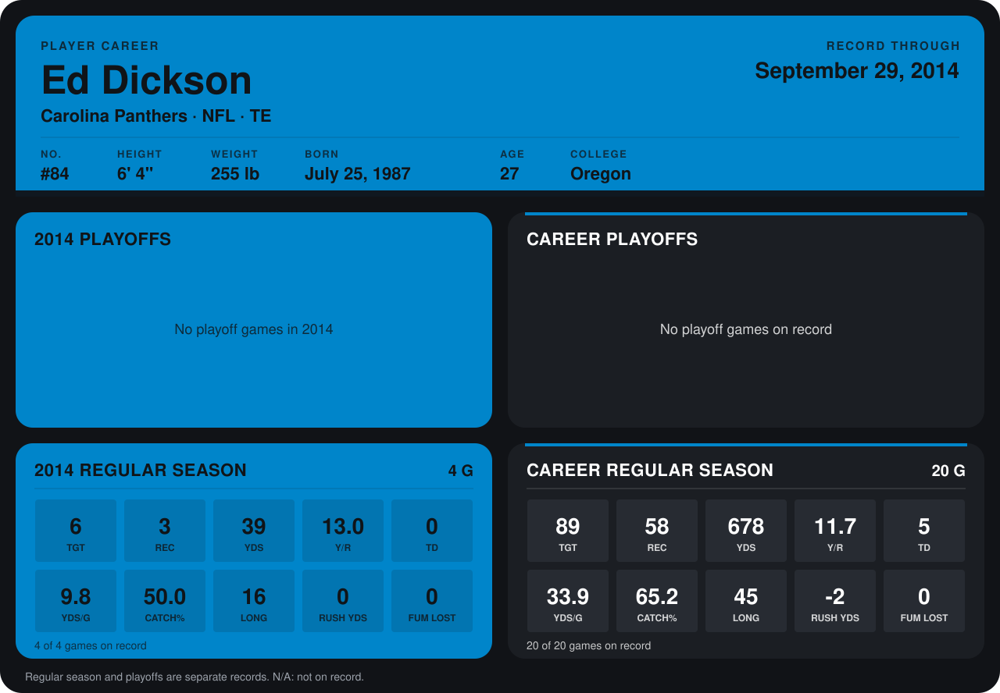

# Ed Dickson

## Career stats

### Regular season

| Season | Club | G | TGT | REC | YDS | Y/R | TD | YDS/G | CATCH% | LONG | RUSH YDS | FUM LOST |
|---|---|---:|---:|---:|---:|---:|---:|---:|---:|---:|---:|---:|
| 2013 | Baltimore Ravens | 16 | 83 | 55 | 639 | 11.6 | 5 | 39.9 | 66.3 | 45 | -2 | 0 |
| 2014 | Carolina Panthers | 4 | 6 | 3 | 39 | 13.0 | 0 | 9.8 | 50.0 | 16 | 0 | 0 |
| **Career** |  | 20 | 89 | 58 | 678 | 11.7 | 5 | 33.9 | 65.2 | 45 | -2 | 0 |

### Playoffs

No playoff games on record.

## Awards

- Pro Bowl selection, replacement (2013, TE)

Records through September 29, 2014. Identity: listed 2014 roster data, Weeks 1-4; number: 2014 Week 1 roster. [All Carolina Panthers players](README.md).
