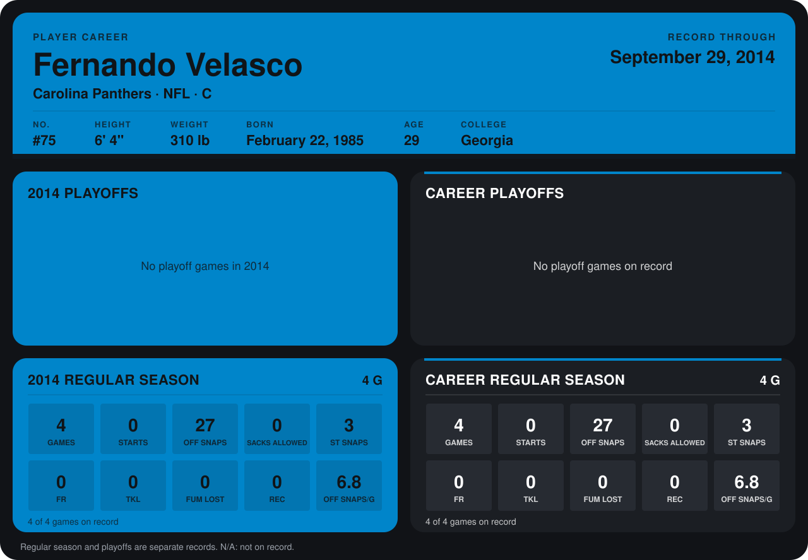

# Fernando Velasco

## Career stats

### Regular season

| Season | Club | G | STARTS | OFF SNAPS | SACKS ALLOWED | ST SNAPS | FR | TKL | FUM LOST | REC | OFF SNAPS/G |
|---|---|---:|---:|---:|---:|---:|---:|---:|---:|---:|---:|
| 2014 | Carolina Panthers | 4 | 0 | 27 | 0 | 3 | 0 | 0 | 0 | 0 | 6.8 |
| **Career** |  | 4 | 0 | 27 | 0 | 3 | 0 | 0 | 0 | 0 | 6.8 |

### Playoffs

No playoff games on record.

## Awards

None on record.

Records through September 29, 2014. Identity: listed 2014 roster data, Weeks 1-4; number: 2014 Week 1 roster. [All Carolina Panthers players](README.md).
