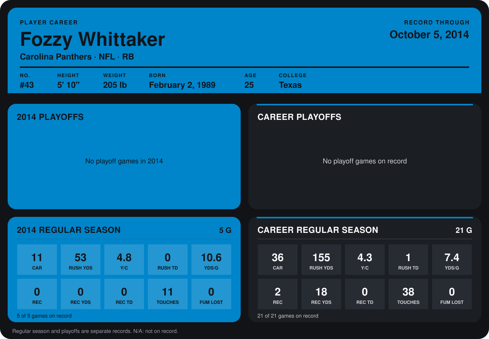

# Fozzy Whittaker

## Career stats

### Regular season

| Season | Club | G | CAR | RUSH YDS | Y/C | RUSH TD | YDS/G | REC | REC YDS | REC TD | TOUCHES | FUM LOST |
|---|---|---:|---:|---:|---:|---:|---:|---:|---:|---:|---:|---:|
| 2013 | San Diego Chargers | 16 | 25 | 102 | 4.1 | 1 | 6.4 | 2 | 18 | 0 | 27 | 0 |
| 2014 | Carolina Panthers | 4 | 4 | 20 | 5.0 | 0 | 5.0 | 0 | 0 | 0 | 4 | 0 |
| **Career** |  | 20 | 29 | 122 | 4.2 | 1 | 6.1 | 2 | 18 | 0 | 31 | 0 |

### Playoffs

No playoff games on record.

## Awards

None on record.

Records through September 28, 2014. Identity: listed 2014 roster data, Weeks 1-4; number: 2014 Week 1 roster. [All Carolina Panthers players](README.md).
