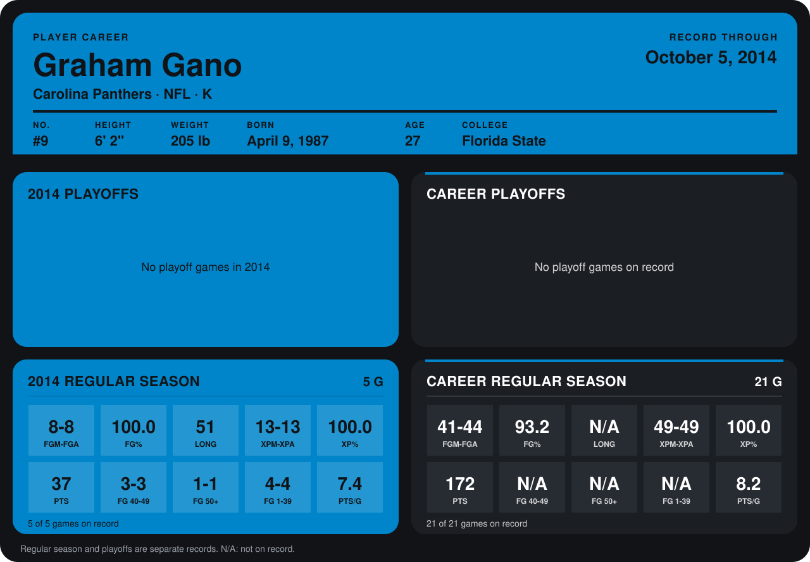

# Graham Gano

## Career stats

### Regular season

| Season | Team | Age | # | G | FGM-FGA | FG% | LONG | XPM-XPA | XP% | PTS | FG 40-49 | FG 50+ | FG 1-39 | PTS/G |
|---|---|---:|---:|---:|---:|---:|---:|---:|---:|---:|---:|---:|---:|---:|
| 2013 | Carolina Panthers | 26 | 9 | 16 | 33-36 | 91.7 | N/A | 36-36 | 100.0 | 135 | N/A | N/A | N/A | 8.4 |
| 2014 | Carolina Panthers | 27 | 9 | 4 | 7-7 | 100.0 | 47 | 10-10 | 100.0 | 31 | 3-3 | 0-0 | 4-4 | 7.8 |
| **Career** |  |  |  | 20 | 40-43 | 93.0 | N/A | 46-46 | 100.0 | 166 | N/A | N/A | N/A | 8.3 |

### Playoffs

No playoff games on record.

## Awards

- NFC Special Teams Player of the Week (2013, Week 2)

Age is his age on the league's opening game of each season; # is the number listed for him that season with that team (2014: the card's rule; 2013: the 2013 season roster), N/A where no listing applies.

Records through September 28, 2014. Identity: listed 2014 roster data, Weeks 1-4; number: 2014 Week 1 roster. [All Carolina Panthers players](README.md).
