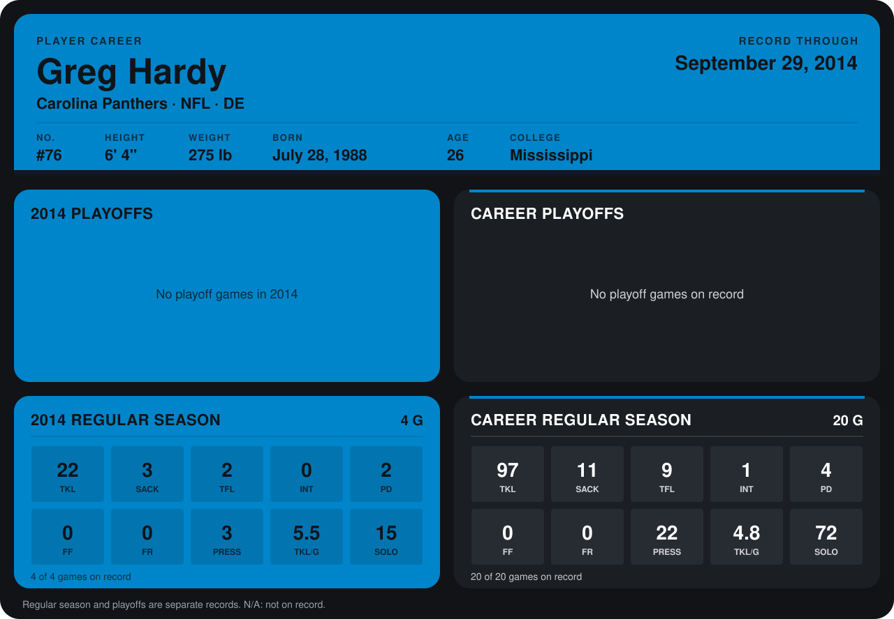

# Greg Hardy

## Career stats

### Regular season

| Season | Club | G | TKL | SACK | TFL | INT | PD | FF | FR | PRESS | TKL/G | SOLO |
|---|---|---:|---:|---:|---:|---:|---:|---:|---:|---:|---:|---:|
| 2013 | Carolina Panthers | 16 | 75 | 8 | 7 | 1 | 2 | 0 | 0 | 19 | 4.7 | 57 |
| 2014 | Carolina Panthers | 4 | 22 | 3 | 2 | 0 | 2 | 0 | 0 | 3 | 5.5 | 15 |
| **Career** |  | 20 | 97 | 11 | 9 | 1 | 4 | 0 | 0 | 22 | 4.8 | 72 |

### Playoffs

No playoff games on record.

## Awards

- NFC Defensive Player of the Week (2013, Week 16)

Records through September 28, 2014. Identity: listed 2014 roster data, Weeks 1-4; number: 2014 Week 1 roster. [All Carolina Panthers players](README.md).
