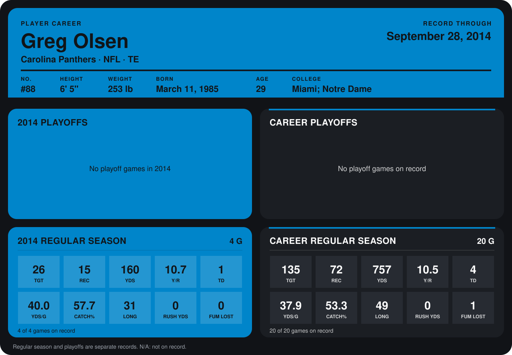

# Greg Olsen

## Career stats

### Regular season

| Season | Club | G | TGT | REC | YDS | Y/R | TD | YDS/G | CATCH% | LONG | RUSH YDS | FUM LOST |
|---|---|---:|---:|---:|---:|---:|---:|---:|---:|---:|---:|---:|
| 2013 | Carolina Panthers | 16 | 109 | 57 | 597 | 10.5 | 3 | 37.3 | 52.3 | 49 | 0 | 1 |
| 2014 | Carolina Panthers | 4 | 26 | 15 | 160 | 10.7 | 1 | 40.0 | 57.7 | 31 | 0 | 0 |
| **Career** |  | 20 | 135 | 72 | 757 | 10.5 | 4 | 37.9 | 53.3 | 49 | 0 | 1 |

### Playoffs

No playoff games on record.

## Awards

None on record.

Records through September 28, 2014. Identity: listed 2014 roster data, Weeks 1-4; number: 2014 Week 1 roster. [All Carolina Panthers players](README.md).
