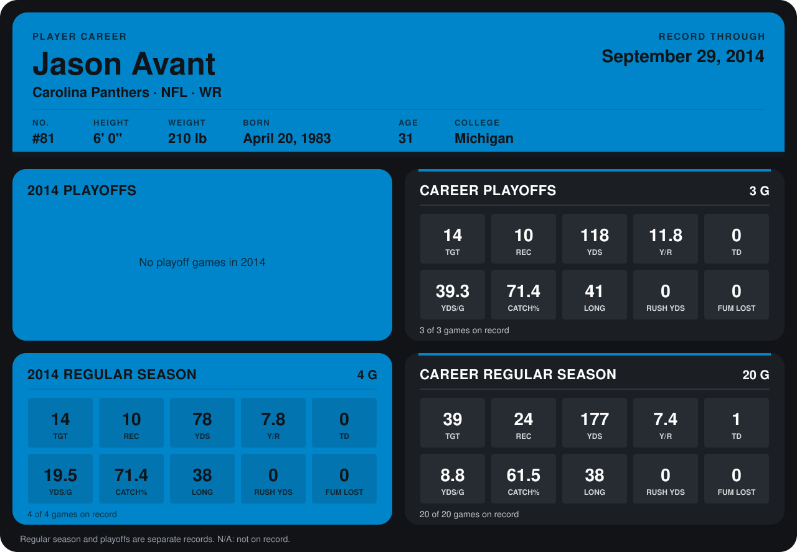

# Jason Avant

## Career stats

### Regular season

| Season | Team | Age | # | G | TGT | REC | YDS | Y/R | TD | YDS/G | CATCH% | LONG | RUSH YDS | FUM LOST |
|---|---|---:|---:|---:|---:|---:|---:|---:|---:|---:|---:|---:|---:|---:|
| 2013 | Philadelphia Eagles | 30 | 81 | 16 | 25 | 14 | 99 | 7.1 | 1 | 6.2 | 56.0 | 13 | 0 | 0 |
| 2014 | Carolina Panthers | 31 | 81 | 5 | 17 | 13 | 123 | 9.5 | 0 | 24.6 | 76.5 | 38 | 20 | 0 |
| **Career** |  |  |  | 21 | 42 | 27 | 222 | 8.2 | 1 | 10.6 | 64.3 | 38 | 20 | 0 |

### Playoffs

| Season | Team | Age | # | G | TGT | REC | YDS | Y/R | TD | YDS/G | CATCH% | LONG | RUSH YDS | FUM LOST |
|---|---|---:|---:|---:|---:|---:|---:|---:|---:|---:|---:|---:|---:|---:|
| 2013 | Philadelphia Eagles | 30 | 81 | 3 | 14 | 10 | 118 | 11.8 | 0 | 39.3 | 71.4 | 41 | 0 | 0 |
| **Career** |  |  |  | 3 | 14 | 10 | 118 | 11.8 | 0 | 39.3 | 71.4 | 41 | 0 | 0 |

## Awards

None on record.

Age is his age on the league's opening game of each season; # is the number listed for him that season with that team (2014: the card's rule; 2013: the 2013 season roster), N/A where no listing applies.

Records through October 5, 2014. Identity: listed 2014 roster data, Weeks 1-4; number: 2014 Week 1 roster. [All Carolina Panthers players](README.md).
