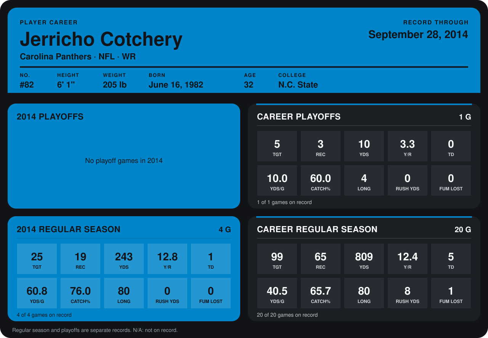

# Jerricho Cotchery

## Career stats

### Regular season

| Season | Club | G | TGT | REC | YDS | Y/R | TD | YDS/G | CATCH% | LONG | RUSH YDS | FUM LOST |
|---|---|---:|---:|---:|---:|---:|---:|---:|---:|---:|---:|---:|
| 2013 | Pittsburgh Steelers | 16 | 74 | 46 | 566 | 12.3 | 4 | 35.4 | 62.2 | 40 | 8 | 1 |
| 2014 | Carolina Panthers | 4 | 25 | 19 | 243 | 12.8 | 1 | 60.8 | 76.0 | 80 | 0 | 0 |
| **Career** |  | 20 | 99 | 65 | 809 | 12.4 | 5 | 40.5 | 65.7 | 80 | 8 | 1 |

### Playoffs

| Season | Club | G | TGT | REC | YDS | Y/R | TD | YDS/G | CATCH% | LONG | RUSH YDS | FUM LOST |
|---|---|---:|---:|---:|---:|---:|---:|---:|---:|---:|---:|---:|
| 2013 | Pittsburgh Steelers | 1 | 5 | 3 | 10 | 3.3 | 0 | 10.0 | 60.0 | 4 | 0 | 0 |
| **Career** |  | 1 | 5 | 3 | 10 | 3.3 | 0 | 10.0 | 60.0 | 4 | 0 | 0 |

## Awards

None on record.

Records through September 29, 2014. Identity: listed 2014 roster data, Weeks 1-4; number: 2014 Week 1 roster. [All Carolina Panthers players](README.md).
