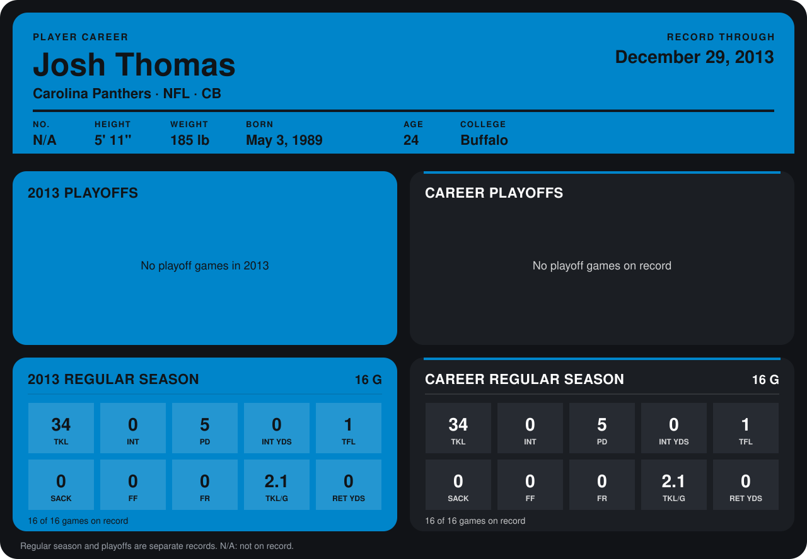

# Josh Thomas

## Career stats

### Regular season

| Season | Club | G | TKL | INT | PD | INT YDS | TFL | SACK | FF | FR | TKL/G | RET YDS |
|---|---|---:|---:|---:|---:|---:|---:|---:|---:|---:|---:|---:|
| 2013 | Carolina Panthers | 16 | 34 | 0 | 5 | 0 | 1 | 0 | 0 | 0 | 2.1 | 0 |
| **Career** |  | 16 | 34 | 0 | 5 | 0 | 1 | 0 | 0 | 0 | 2.1 | 0 |

### Playoffs

No playoff games on record.

## Awards

None on record.

Records through December 29, 2013. Identity: listed 2014 roster data, Weeks 1-4. [All Carolina Panthers players](README.md).
