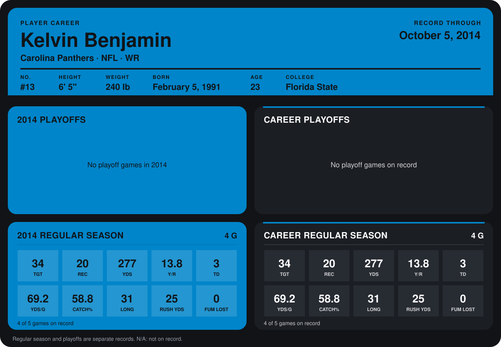

# Kelvin Benjamin

## Career stats

### Regular season

| Season | Club | G | TGT | REC | YDS | Y/R | TD | YDS/G | CATCH% | LONG | RUSH YDS | FUM LOST |
|---|---|---:|---:|---:|---:|---:|---:|---:|---:|---:|---:|---:|
| 2014 | Carolina Panthers | 3 | 31 | 19 | 264 | 13.9 | 3 | 88.0 | 61.3 | 31 | 25 | 0 |
| **Career** |  | 3 | 31 | 19 | 264 | 13.9 | 3 | 88.0 | 61.3 | 31 | 25 | 0 |

### Playoffs

No playoff games on record.

## Awards

None on record.

Records through September 29, 2014. Identity: listed 2014 roster data, Weeks 1-4; number: 2014 Week 1 roster. [All Carolina Panthers players](README.md).
