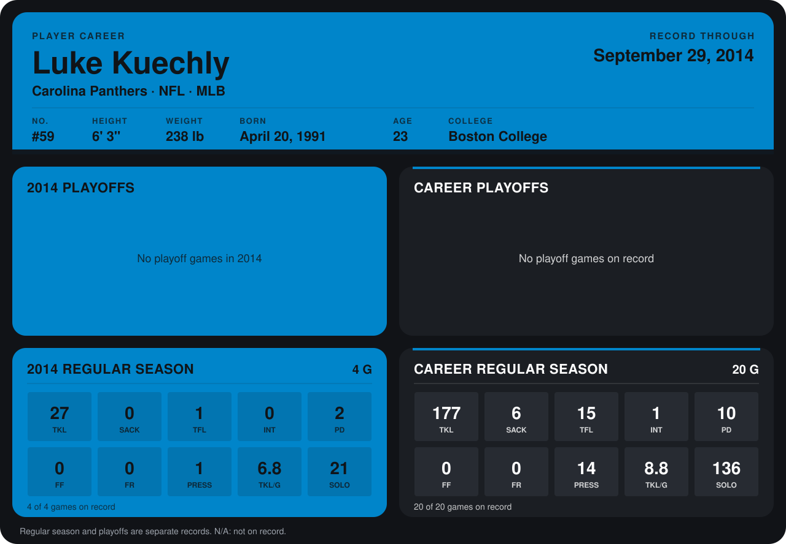

# Luke Kuechly

## Career stats

### Regular season

| Season | Club | G | TKL | SACK | TFL | INT | PD | FF | FR | PRESS | TKL/G | SOLO |
|---|---|---:|---:|---:|---:|---:|---:|---:|---:|---:|---:|---:|
| 2013 | Carolina Panthers | 16 | 150 | 6 | 14 | 1 | 8 | 0 | 0 | 13 | 9.4 | 115 |
| 2014 | Carolina Panthers | 4 | 27 | 0 | 1 | 0 | 2 | 0 | 0 | 1 | 6.8 | 21 |
| **Career** |  | 20 | 177 | 6 | 15 | 1 | 10 | 0 | 0 | 14 | 8.8 | 136 |

### Playoffs

No playoff games on record.

## Awards

- NFC Defensive Player of the Week (2013, Week 8)
- NFC Defensive Player of the Month (2013, October)

Records through September 29, 2014. Identity: listed 2014 roster data, Weeks 1-4; number: 2014 Week 1 roster. [All Carolina Panthers players](README.md).
