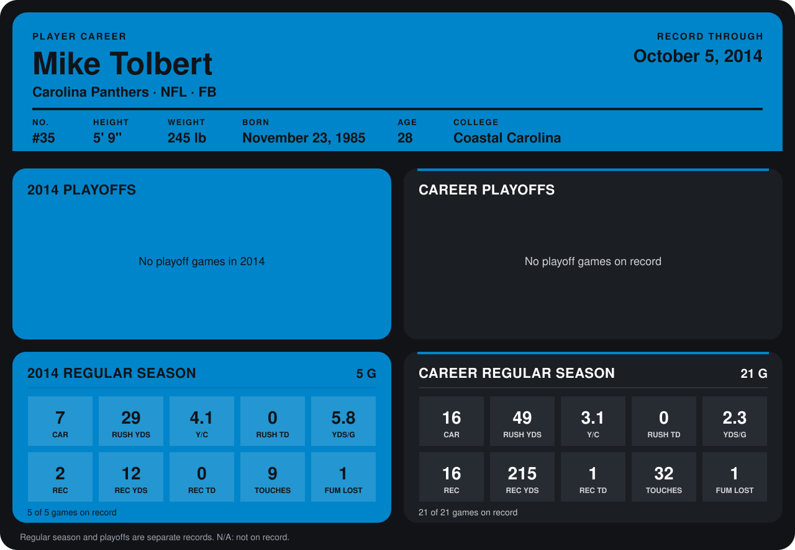

# Mike Tolbert

## Career stats

### Regular season

| Season | Team | Age | # | G | CAR | RUSH YDS | Y/C | RUSH TD | YDS/G | REC | REC YDS | REC TD | TOUCHES | FUM LOST |
|---|---|---:|---:|---:|---:|---:|---:|---:|---:|---:|---:|---:|---:|---:|
| 2013 | Carolina Panthers | 27 | 35 | 16 | 9 | 20 | 2.2 | 0 | 1.2 | 14 | 203 | 1 | 23 | 0 |
| 2014 | Carolina Panthers | 28 | 35 | 5 | 7 | 29 | 4.1 | 0 | 5.8 | 2 | 12 | 0 | 9 | 1 |
| **Career** |  |  |  | 21 | 16 | 49 | 3.1 | 0 | 2.3 | 16 | 215 | 1 | 32 | 1 |

### Playoffs

No playoff games on record.

## Awards

- AP Second-Team All-Pro (2013, FB)
- Pro Bowl selection (2013, FB)

Age is his age on the league's opening game of each season; # is the number listed for him that season with that team (2014: the card's rule; 2013: the 2013 season roster), N/A where no listing applies.

Records through October 5, 2014. Identity: listed 2014 roster data, Weeks 1-4; number: 2014 Week 1 roster. [All Carolina Panthers players](README.md).
