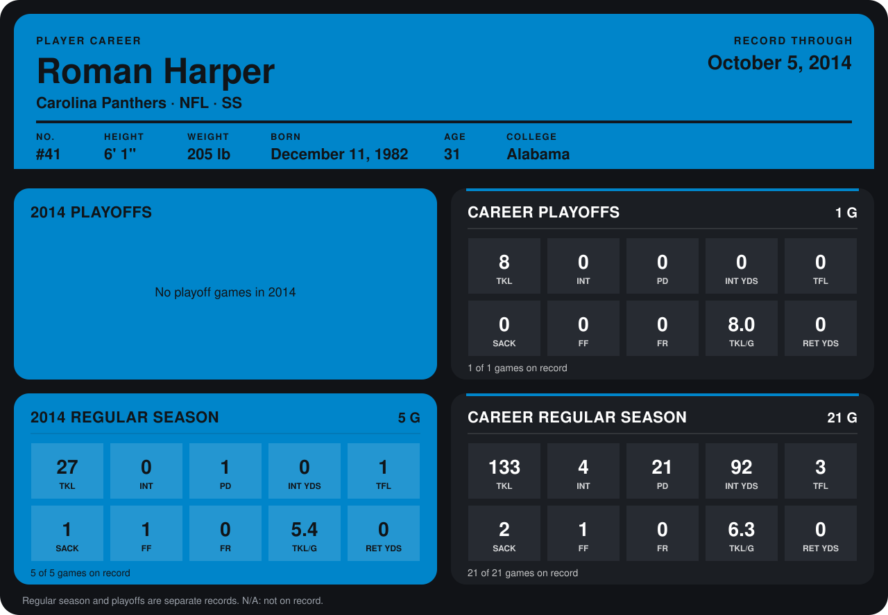

# Roman Harper

## Career stats

### Regular season

| Season | Club | G | TKL | INT | PD | INT YDS | TFL | SACK | FF | FR | TKL/G | RET YDS |
|---|---|---:|---:|---:|---:|---:|---:|---:|---:|---:|---:|---:|
| 2013 | New Orleans Saints | 16 | 106 | 4 | 20 | 92 | 2 | 1 | 0 | 0 | 6.6 | 0 |
| 2014 | Carolina Panthers | 4 | 22 | 0 | 1 | 0 | 1 | 0 | 0 | 0 | 5.5 | 0 |
| **Career** |  | 20 | 128 | 4 | 21 | 92 | 3 | 1 | 0 | 0 | 6.4 | 0 |

### Playoffs

| Season | Club | G | TKL | INT | PD | INT YDS | TFL | SACK | FF | FR | TKL/G | RET YDS |
|---|---|---:|---:|---:|---:|---:|---:|---:|---:|---:|---:|---:|
| 2013 | New Orleans Saints | 1 | 8 | 0 | 0 | 0 | 0 | 0 | 0 | 0 | 8.0 | 0 |
| **Career** |  | 1 | 8 | 0 | 0 | 0 | 0 | 0 | 0 | 0 | 8.0 | 0 |

## Awards

- NFC Defensive Player of the Week (2013, Week 15)

Records through September 28, 2014. Identity: listed 2014 roster data, Weeks 1-4; number: 2014 Week 1 roster. [All Carolina Panthers players](README.md).
