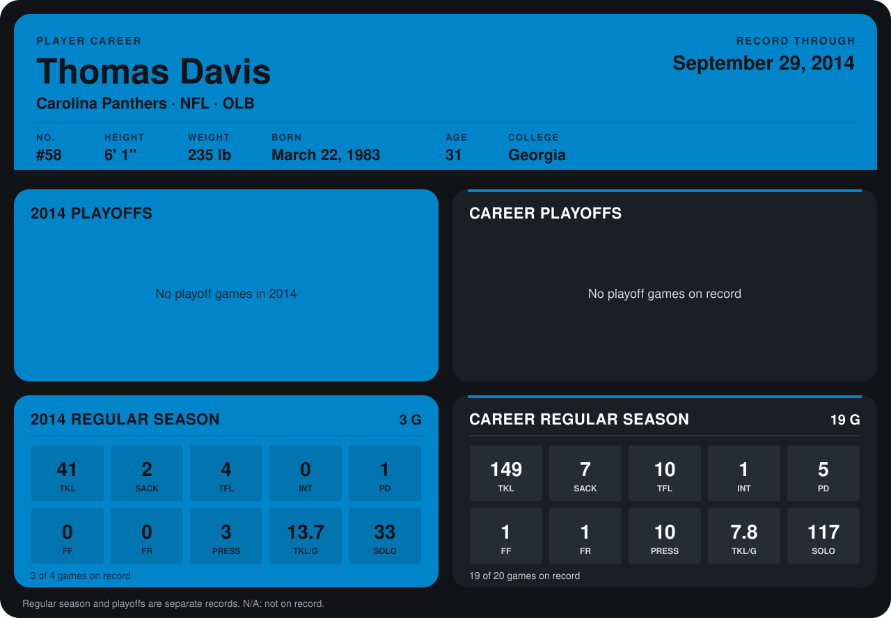

# Thomas Davis

## Career stats

### Regular season

| Season | Club | G | TKL | SACK | TFL | INT | PD | FF | FR | PRESS | TKL/G | SOLO |
|---|---|---:|---:|---:|---:|---:|---:|---:|---:|---:|---:|---:|
| 2013 | Carolina Panthers | 16 | 108 | 5 | 6 | 1 | 4 | 1 | 1 | 7 | 6.8 | 84 |
| 2014 | Carolina Panthers | 3 | 41 | 2 | 4 | 0 | 1 | 0 | 0 | 3 | 13.7 | 33 |
| **Career** |  | 19 | 149 | 7 | 10 | 1 | 5 | 1 | 1 | 10 | 7.8 | 117 |

### Playoffs

No playoff games on record.

## Awards

None on record.

Records through September 28, 2014. Identity: listed 2014 roster data, Weeks 1-4; number: 2014 Week 1 roster. [All Carolina Panthers players](README.md).
