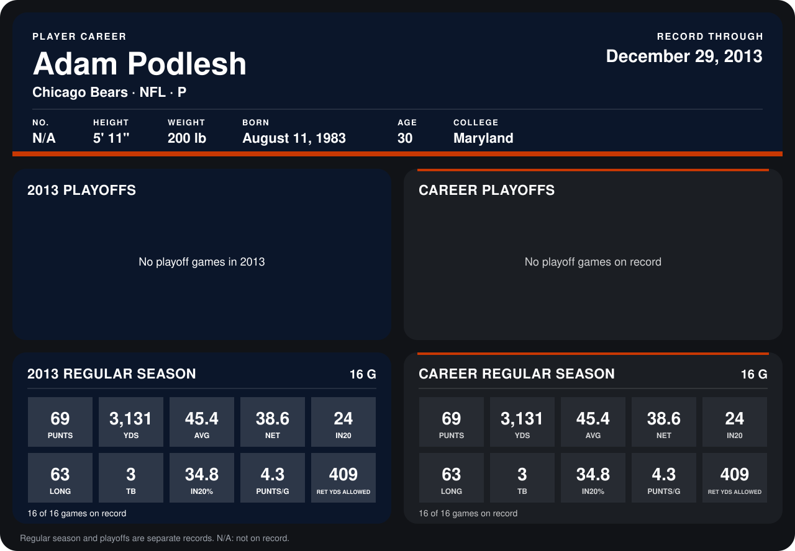

# Adam Podlesh

## Career stats

### Regular season

| Season | Club | G | PUNTS | YDS | AVG | NET | IN20 | LONG | TB | IN20% | PUNTS/G | RET YDS ALLOWED |
|---|---|---:|---:|---:|---:|---:|---:|---:|---:|---:|---:|---:|
| 2013 | Chicago Bears | 16 | 69 | 3,131 | 45.4 | 38.6 | 24 | 63 | 3 | 34.8 | 4.3 | 409 |
| **Career** |  | 16 | 69 | 3,131 | 45.4 | 38.6 | 24 | 63 | 3 | 34.8 | 4.3 | 409 |

### Playoffs

No playoff games on record.

## Awards

None on record.

Records through December 29, 2013. Identity: his listed 2013 season roster data (no 2014 Weeks 1-4 roster row). [All Chicago Bears players](README.md).
