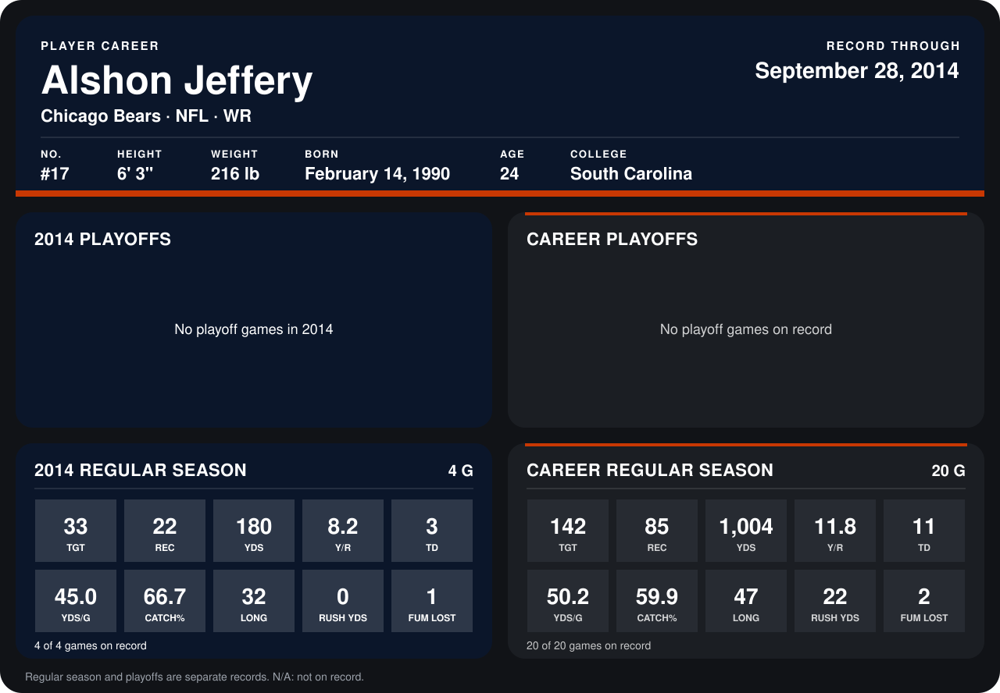

# Alshon Jeffery

## Career stats

### Regular season

| Season | Team | Age | # | G | TGT | REC | YDS | Y/R | TD | YDS/G | CATCH% | LONG | RUSH YDS | FUM LOST |
|---|---|---:|---:|---:|---:|---:|---:|---:|---:|---:|---:|---:|---:|---:|
| 2013 | Chicago Bears | 23 | 17 | 16 | 109 | 63 | 824 | 13.1 | 8 | 51.5 | 57.8 | 47 | 22 | 1 |
| 2014 | Chicago Bears | 24 | 17 | 5 | 38 | 26 | 270 | 10.4 | 3 | 54.0 | 68.4 | 35 | 0 | 1 |
| **Career** |  |  |  | 21 | 147 | 89 | 1,094 | 12.3 | 11 | 52.1 | 60.5 | 47 | 22 | 2 |

### Playoffs

No playoff games on record.

## Awards

None on record.

Age is his age on the league's opening game of each season; # is the number listed for him that season with that team (2014: the card's rule; 2013: the 2013 season roster), N/A where no listing applies.

Records through October 5, 2014. Identity: listed 2014 roster data, Weeks 1-4; number: 2014 Week 1 roster. [All Chicago Bears players](README.md).
