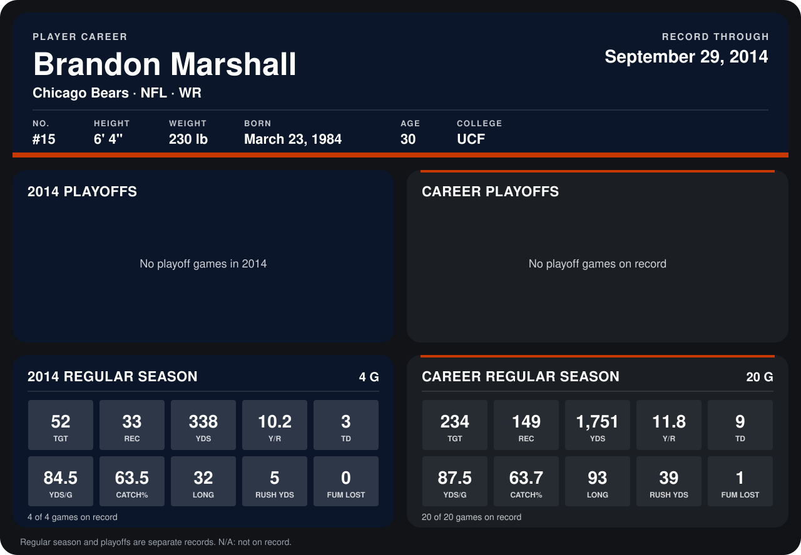

# Brandon Marshall

## Career stats

### Regular season

| Season | Team | Age | # | G | TGT | REC | YDS | Y/R | TD | YDS/G | CATCH% | LONG | RUSH YDS | FUM LOST |
|---|---|---:|---:|---:|---:|---:|---:|---:|---:|---:|---:|---:|---:|---:|
| 2013 | Chicago Bears | 29 | 15 | 16 | 182 | 116 | 1,413 | 12.2 | 6 | 88.3 | 63.7 | 93 | 34 | 1 |
| 2014 | Chicago Bears | 30 | 15 | 5 | 59 | 38 | 364 | 9.6 | 3 | 72.8 | 64.4 | 32 | 5 | 0 |
| **Career** |  |  |  | 21 | 241 | 154 | 1,777 | 11.5 | 9 | 84.6 | 63.9 | 93 | 39 | 1 |

### Playoffs

No playoff games on record.

## Awards

- Pro Bowl selection (2013, WR)

Age is his age on the league's opening game of each season; # is the number listed for him that season with that team (2014: the card's rule; 2013: the 2013 season roster), N/A where no listing applies.

Records through October 5, 2014. Identity: listed 2014 roster data, Weeks 1-4; number: 2014 Week 1 roster. [All Chicago Bears players](README.md).
