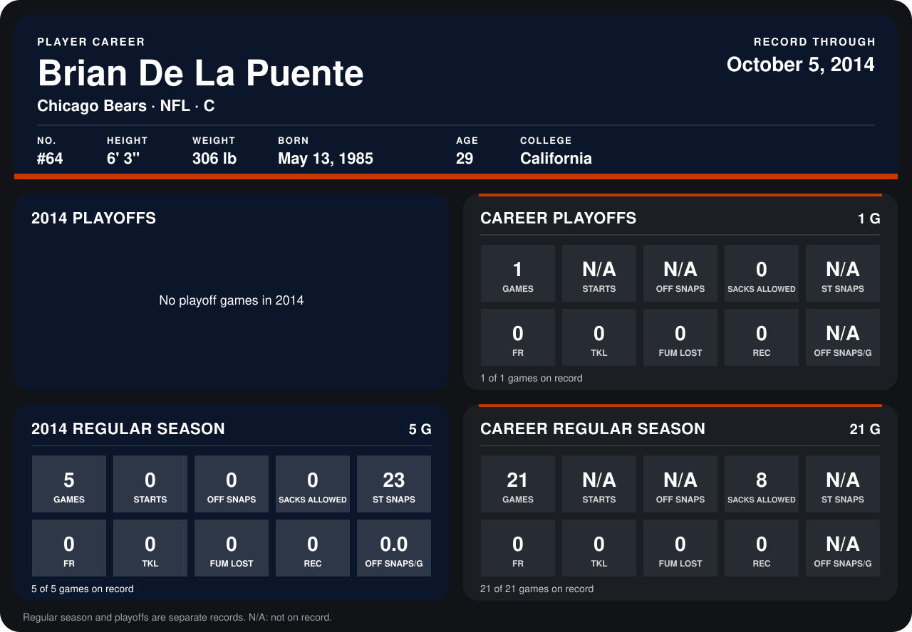

# Brian De La Puente

## Career stats

### Regular season

| Season | Club | G | STARTS | OFF SNAPS | SACKS ALLOWED | ST SNAPS | FR | TKL | FUM LOST | REC | OFF SNAPS/G |
|---|---|---:|---:|---:|---:|---:|---:|---:|---:|---:|---:|
| 2013 | New Orleans Saints | 16 | N/A | N/A | 8 | N/A | 0 | 0 | 0 | 0 | N/A |
| 2014 | Chicago Bears | 4 | 0 | 0 | 0 | 19 | 0 | 0 | 0 | 0 | 0.0 |
| **Career** |  | 20 | N/A | N/A | 8 | N/A | 0 | 0 | 0 | 0 | N/A |

### Playoffs

| Season | Club | G | STARTS | OFF SNAPS | SACKS ALLOWED | ST SNAPS | FR | TKL | FUM LOST | REC | OFF SNAPS/G |
|---|---|---:|---:|---:|---:|---:|---:|---:|---:|---:|---:|
| 2013 | New Orleans Saints | 1 | N/A | N/A | 0 | N/A | 0 | 0 | 0 | 0 | N/A |
| **Career** |  | 1 | N/A | N/A | 0 | N/A | 0 | 0 | 0 | 0 | N/A |

## Awards

None on record.

Records through September 29, 2014. Identity: listed 2014 roster data, Weeks 1-4; number: 2014 Week 1 roster. [All Chicago Bears players](README.md).
