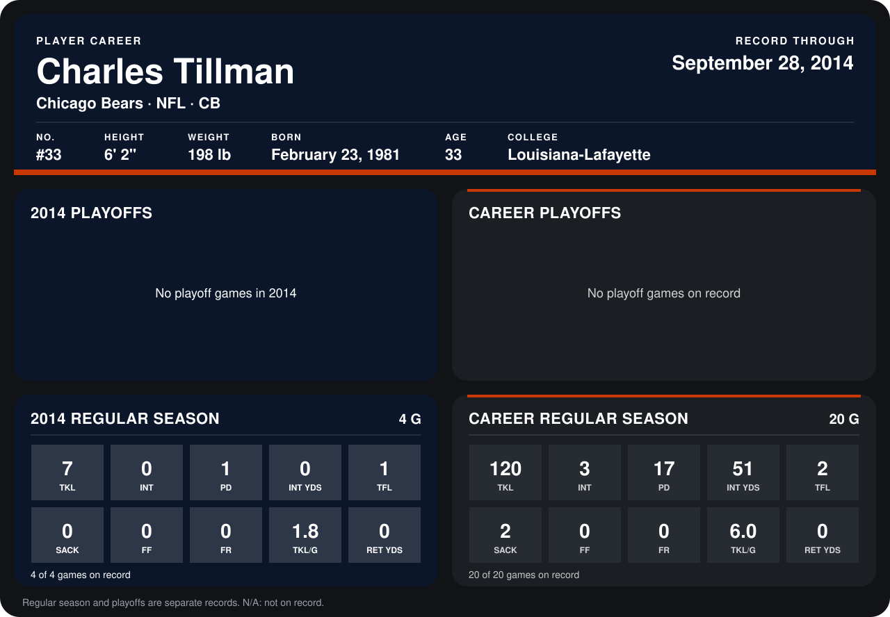

# Charles Tillman

## Career stats

### Regular season

| Season | Club | G | TKL | INT | PD | INT YDS | TFL | SACK | FF | FR | TKL/G | RET YDS |
|---|---|---:|---:|---:|---:|---:|---:|---:|---:|---:|---:|---:|
| 2013 | Chicago Bears | 16 | 113 | 3 | 16 | 51 | 1 | 2 | 0 | 0 | 7.1 | 0 |
| 2014 | Chicago Bears | 4 | 7 | 0 | 1 | 0 | 1 | 0 | 0 | 0 | 1.8 | 0 |
| **Career** |  | 20 | 120 | 3 | 17 | 51 | 2 | 2 | 0 | 0 | 6.0 | 0 |

### Playoffs

No playoff games on record.

## Awards

- Pro Bowl selection (2013, CB)

Records through September 28, 2014. Identity: listed 2014 roster data, Weeks 1-4; number: 2014 Week 1 roster. [All Chicago Bears players](README.md).
