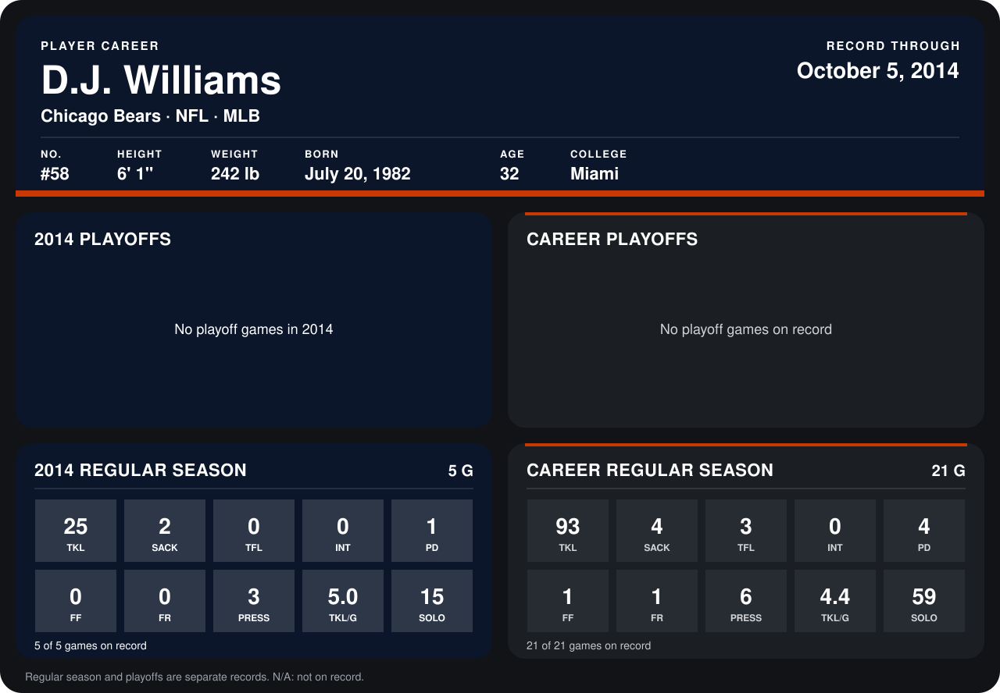

# D.J. Williams

## Career stats

### Regular season

| Season | Team | Age | # | G | TKL | SACK | TFL | INT | PD | FF | FR | PRESS | TKL/G | SOLO |
|---|---|---:|---:|---:|---:|---:|---:|---:|---:|---:|---:|---:|---:|---:|
| 2013 | Chicago Bears | 31 | 58 | 16 | 68 | 2 | 3 | 0 | 3 | 1 | 1 | 3 | 4.2 | 44 |
| 2014 | Chicago Bears | 32 | 58 | 4 | 19 | 1 | 0 | 0 | 1 | 0 | 0 | 2 | 4.8 | 11 |
| **Career** |  |  |  | 20 | 87 | 3 | 3 | 0 | 4 | 1 | 1 | 5 | 4.3 | 55 |

### Playoffs

No playoff games on record.

## Awards

None on record.

Age is his age on the league's opening game of each season; # is the number listed for him that season with that team (2014: the card's rule; 2013: the 2013 season roster), N/A where no listing applies.

Records through September 28, 2014. Identity: listed 2014 roster data, Weeks 1-4; number: 2014 Week 1 roster. [All Chicago Bears players](README.md).
