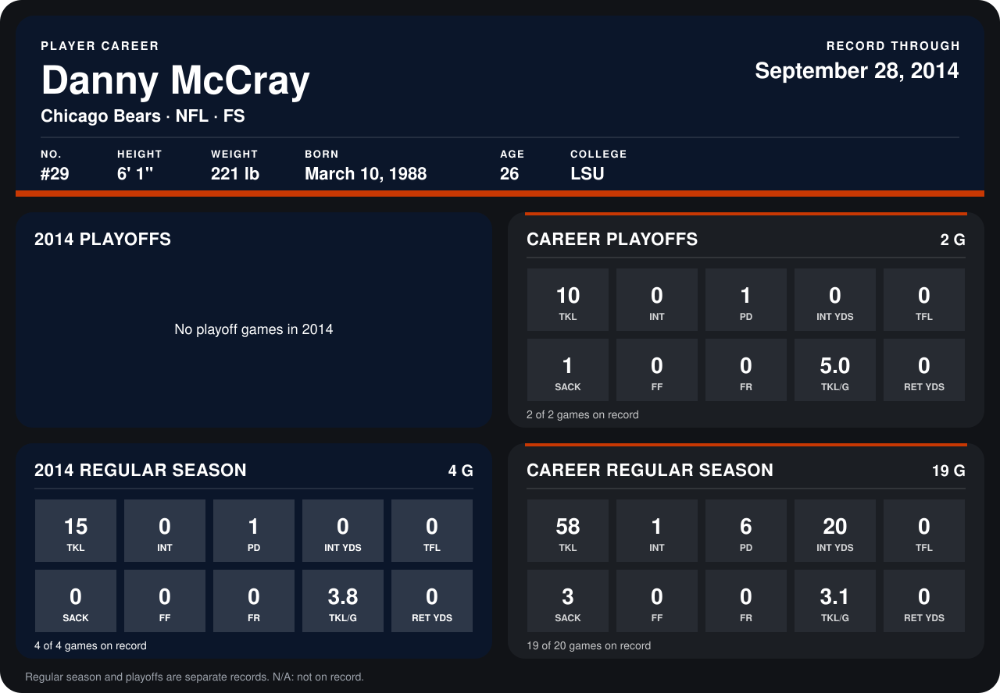

# Danny McCray

## Career stats

### Regular season

| Season | Club | G | TKL | INT | PD | INT YDS | TFL | SACK | FF | FR | TKL/G | RET YDS |
|---|---|---:|---:|---:|---:|---:|---:|---:|---:|---:|---:|---:|
| 2013 | Dallas Cowboys | 15 | 43 | 1 | 5 | 20 | 0 | 3 | 0 | 0 | 2.9 | 0 |
| 2014 | Chicago Bears | 4 | 15 | 0 | 1 | 0 | 0 | 0 | 0 | 0 | 3.8 | 0 |
| **Career** |  | 19 | 58 | 1 | 6 | 20 | 0 | 3 | 0 | 0 | 3.1 | 0 |

### Playoffs

| Season | Club | G | TKL | INT | PD | INT YDS | TFL | SACK | FF | FR | TKL/G | RET YDS |
|---|---|---:|---:|---:|---:|---:|---:|---:|---:|---:|---:|---:|
| 2013 | Dallas Cowboys | 2 | 10 | 0 | 1 | 0 | 0 | 1 | 0 | 0 | 5.0 | 0 |
| **Career** |  | 2 | 10 | 0 | 1 | 0 | 0 | 1 | 0 | 0 | 5.0 | 0 |

## Awards

None on record.

Records through September 28, 2014. Identity: listed 2014 roster data, Weeks 1-4; number: 2014 Week 1 roster. [All Chicago Bears players](README.md).
