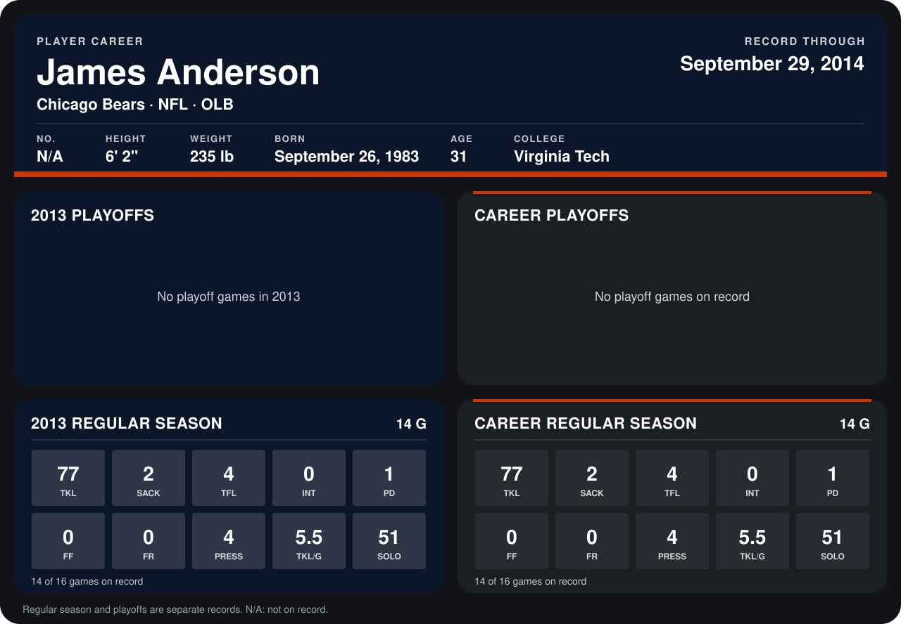

# James Anderson

## Career stats

### Regular season

| Season | Club | G | TKL | SACK | TFL | INT | PD | FF | FR | PRESS | TKL/G | SOLO |
|---|---|---:|---:|---:|---:|---:|---:|---:|---:|---:|---:|---:|
| 2013 | Chicago Bears | 14 | 77 | 2 | 4 | 0 | 1 | 0 | 0 | 4 | 5.5 | 51 |
| **Career** |  | 14 | 77 | 2 | 4 | 0 | 1 | 0 | 0 | 4 | 5.5 | 51 |

### Playoffs

No playoff games on record.

## Awards

None on record.

Records through September 29, 2014. Identity: listed 2014 roster data, Weeks 1-4. [All Chicago Bears players](README.md).
