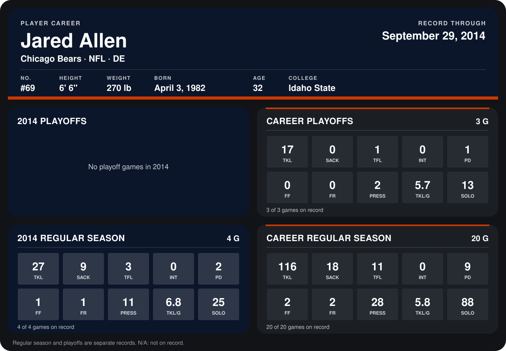

# Jared Allen

## Career stats

### Regular season

| Season | Team | Age | # | G | TKL | SACK | TFL | INT | PD | FF | FR | PRESS | TKL/G | SOLO |
|---|---|---:|---:|---:|---:|---:|---:|---:|---:|---:|---:|---:|---:|---:|
| 2013 | Minnesota Vikings | 31 | 69 | 16 | 89 | 9 | 8 | 0 | 7 | 1 | 1 | 17 | 5.6 | 63 |
| 2014 | Chicago Bears | 32 | 69 | 4 | 27 | 9 | 3 | 0 | 2 | 1 | 1 | 11 | 6.8 | 25 |
| **Career** |  |  |  | 20 | 116 | 18 | 11 | 0 | 9 | 2 | 2 | 28 | 5.8 | 88 |

### Playoffs

| Season | Team | Age | # | G | TKL | SACK | TFL | INT | PD | FF | FR | PRESS | TKL/G | SOLO |
|---|---|---:|---:|---:|---:|---:|---:|---:|---:|---:|---:|---:|---:|---:|
| 2013 | Minnesota Vikings | 31 | 69 | 3 | 17 | 0 | 1 | 0 | 1 | 0 | 0 | 2 | 5.7 | 13 |
| **Career** |  |  |  | 3 | 17 | 0 | 1 | 0 | 1 | 0 | 0 | 2 | 5.7 | 13 |

## Awards

- Pro Bowl selection (2013, DE)

Age is his age on the league's opening game of each season; # is the number listed for him that season with that team (2014: the card's rule; 2013: the 2013 season roster), N/A where no listing applies.

Records through September 28, 2014. Identity: listed 2014 roster data, Weeks 1-4; number: 2014 Week 1 roster. [All Chicago Bears players](README.md).
