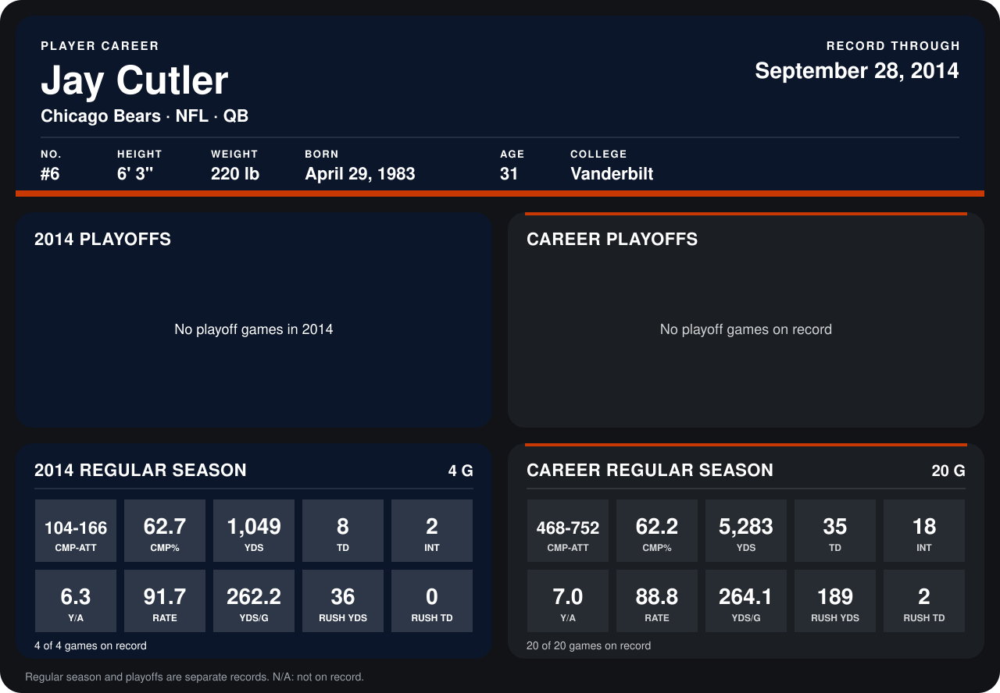

# Jay Cutler

## Career stats

### Regular season

| Season | Club | G | CMP-ATT | CMP% | YDS | TD | INT | Y/A | RATE | YDS/G | RUSH YDS | RUSH TD |
|---|---|---:|---:|---:|---:|---:|---:|---:|---:|---:|---:|---:|
| 2013 | Chicago Bears | 16 | 364-586 | 62.1 | 4,234 | 27 | 16 | 7.2 | 87.9 | 264.6 | 153 | 2 |
| 2014 | Chicago Bears | 4 | 104-166 | 62.7 | 1,049 | 8 | 2 | 6.3 | 91.7 | 262.2 | 36 | 0 |
| **Career** |  | 20 | 468-752 | 62.2 | 5,283 | 35 | 18 | 7.0 | 88.8 | 264.1 | 189 | 2 |

### Playoffs

No playoff games on record.

## Awards

- NFC Offensive Player of the Week (2013, Week 10)
- Pro Bowl selection (2013, QB)

Records through September 28, 2014. Identity: listed 2014 roster data, Weeks 1-4; number: 2014 Week 1 roster. [All Chicago Bears players](README.md).
