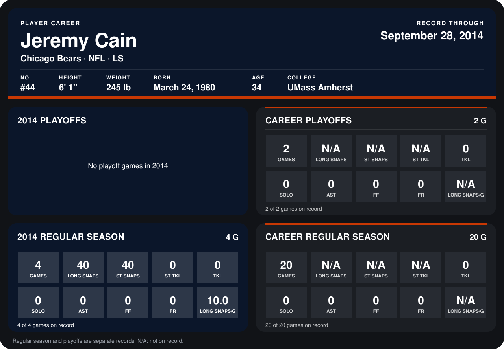

# Jeremy Cain

## Career stats

### Regular season

| Season | Club | G | LONG SNAPS | ST SNAPS | ST TKL | TKL | SOLO | AST | FF | FR | LONG SNAPS/G |
|---|---|---:|---:|---:|---:|---:|---:|---:|---:|---:|---:|
| 2013 | Jacksonville Jaguars | 16 | N/A | N/A | N/A | 0 | 0 | 0 | 0 | 0 | N/A |
| 2014 | Chicago Bears | 4 | 40 | 40 | 0 | 0 | 0 | 0 | 0 | 0 | 10.0 |
| **Career** |  | 20 | N/A | N/A | N/A | 0 | 0 | 0 | 0 | 0 | N/A |

### Playoffs

| Season | Club | G | LONG SNAPS | ST SNAPS | ST TKL | TKL | SOLO | AST | FF | FR | LONG SNAPS/G |
|---|---|---:|---:|---:|---:|---:|---:|---:|---:|---:|---:|
| 2013 | Jacksonville Jaguars | 2 | N/A | N/A | N/A | 0 | 0 | 0 | 0 | 0 | N/A |
| **Career** |  | 2 | N/A | N/A | N/A | 0 | 0 | 0 | 0 | 0 | N/A |

## Awards

None on record.

Records through September 29, 2014. Identity: listed 2014 roster data, Weeks 1-4; number: 2014 Week 4 roster listing. [All Chicago Bears players](README.md).
