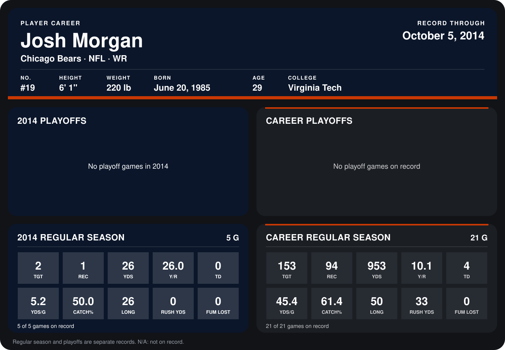

# Josh Morgan

## Career stats

### Regular season

| Season | Club | G | TGT | REC | YDS | Y/R | TD | YDS/G | CATCH% | LONG | RUSH YDS | FUM LOST |
|---|---|---:|---:|---:|---:|---:|---:|---:|---:|---:|---:|---:|
| 2013 | Washington Redskins | 16 | 151 | 93 | 927 | 10.0 | 4 | 57.9 | 61.6 | 50 | 33 | 0 |
| 2014 | Chicago Bears | 5 | 2 | 1 | 26 | 26.0 | 0 | 5.2 | 50.0 | 26 | 0 | 0 |
| **Career** |  | 21 | 153 | 94 | 953 | 10.1 | 4 | 45.4 | 61.4 | 50 | 33 | 0 |

### Playoffs

No playoff games on record.

## Awards

None on record.

Records through October 5, 2014. Identity: listed 2014 roster data, Weeks 1-4; number: 2014 Week 1 roster. [All Chicago Bears players](README.md).
