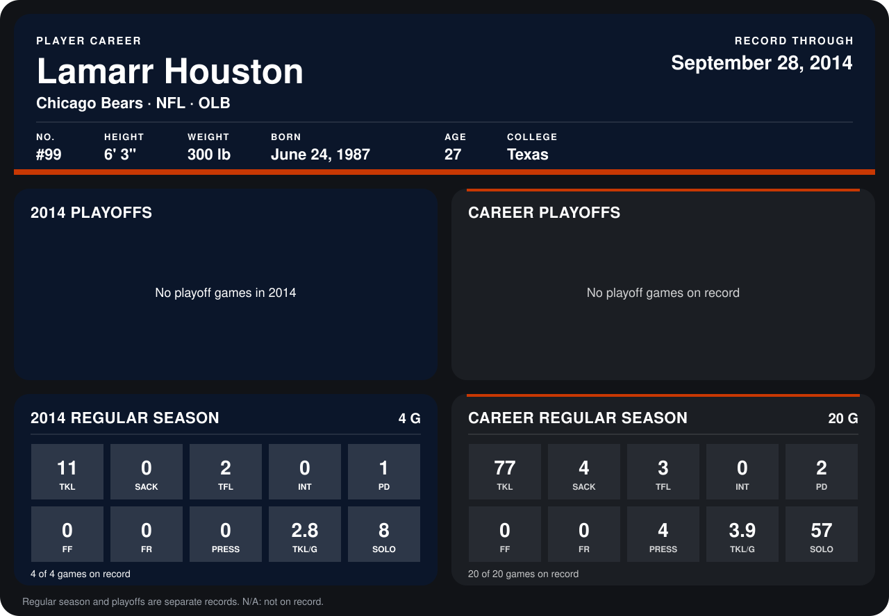

# Lamarr Houston

## Career stats

### Regular season

| Season | Club | G | TKL | SACK | TFL | INT | PD | FF | FR | PRESS | TKL/G | SOLO |
|---|---|---:|---:|---:|---:|---:|---:|---:|---:|---:|---:|---:|
| 2013 | Oakland Raiders | 16 | 66 | 4 | 1 | 0 | 1 | 0 | 0 | 4 | 4.1 | 49 |
| 2014 | Chicago Bears | 4 | 11 | 0 | 2 | 0 | 1 | 0 | 0 | 0 | 2.8 | 8 |
| **Career** |  | 20 | 77 | 4 | 3 | 0 | 2 | 0 | 0 | 4 | 3.9 | 57 |

### Playoffs

No playoff games on record.

## Awards

None on record.

Records through September 28, 2014. Identity: listed 2014 roster data, Weeks 1-4; number: 2014 Week 1 roster. [All Chicago Bears players](README.md).
