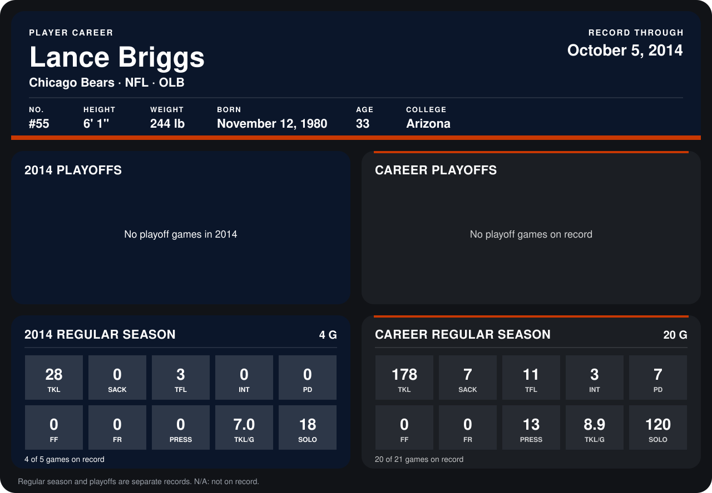

# Lance Briggs

## Career stats

### Regular season

| Season | Team | Age | # | G | TKL | SACK | TFL | INT | PD | FF | FR | PRESS | TKL/G | SOLO |
|---|---|---:|---:|---:|---:|---:|---:|---:|---:|---:|---:|---:|---:|---:|
| 2013 | Chicago Bears | 32 | 55 | 16 | 150 | 7 | 8 | 3 | 7 | 0 | 0 | 13 | 9.4 | 102 |
| 2014 | Chicago Bears | 33 | 55 | 3 | 18 | 0 | 2 | 0 | 0 | 0 | 0 | 0 | 6.0 | 11 |
| **Career** |  |  |  | 19 | 168 | 7 | 10 | 3 | 7 | 0 | 0 | 13 | 8.8 | 113 |

### Playoffs

No playoff games on record.

## Awards

- NFC Defensive Player of the Month (2013, November)
- AP Second-Team All-Pro (2013, OLB)
- Pro Bowl selection (2013, OLB)

Age is his age on the league's opening game of each season; # is the number listed for him that season with that team (2014: the card's rule; 2013: the 2013 season roster), N/A where no listing applies.

Records through September 28, 2014. Identity: listed 2014 roster data, Weeks 1-4; number: 2014 Week 1 roster. [All Chicago Bears players](README.md).
