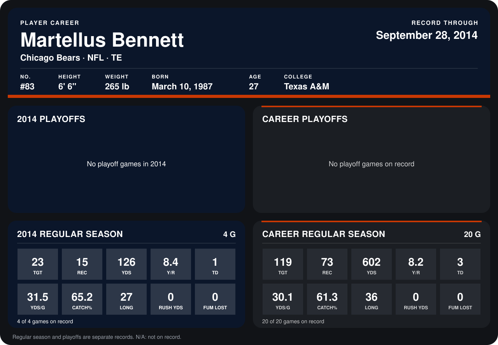

# Martellus Bennett

## Career stats

### Regular season

| Season | Club | G | TGT | REC | YDS | Y/R | TD | YDS/G | CATCH% | LONG | RUSH YDS | FUM LOST |
|---|---|---:|---:|---:|---:|---:|---:|---:|---:|---:|---:|---:|
| 2013 | Chicago Bears | 16 | 96 | 58 | 476 | 8.2 | 2 | 29.8 | 60.4 | 36 | 0 | 0 |
| 2014 | Chicago Bears | 4 | 23 | 15 | 126 | 8.4 | 1 | 31.5 | 65.2 | 27 | 0 | 0 |
| **Career** |  | 20 | 119 | 73 | 602 | 8.2 | 3 | 30.1 | 61.3 | 36 | 0 | 0 |

### Playoffs

No playoff games on record.

## Awards

None on record.

Records through September 28, 2014. Identity: listed 2014 roster data, Weeks 1-4; number: 2014 Week 1 roster. [All Chicago Bears players](README.md).
