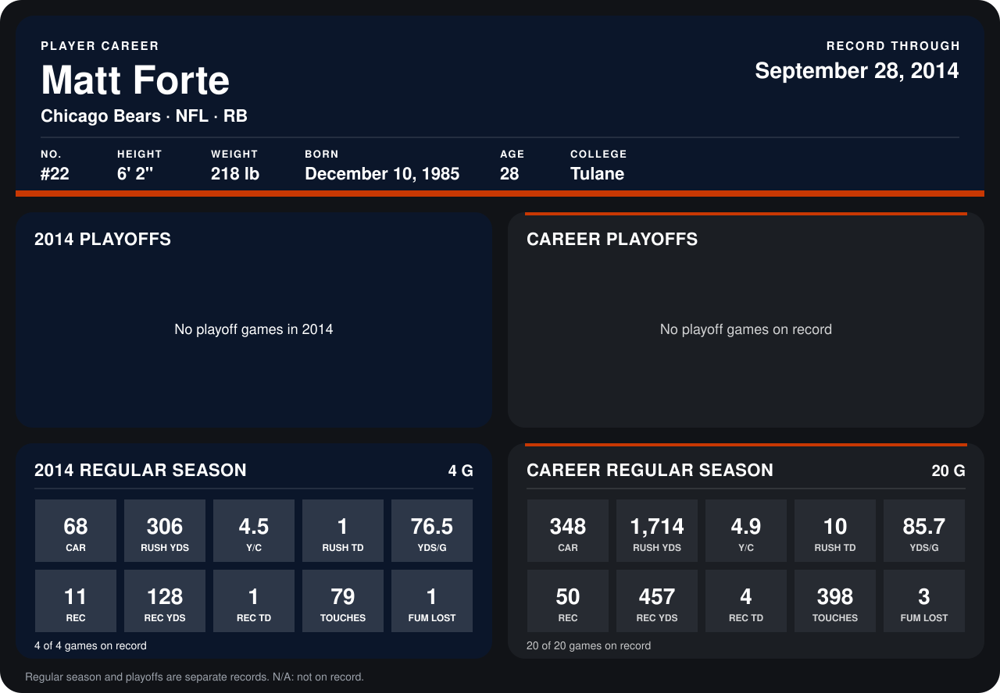

# Matt Forte

## Career stats

### Regular season

| Season | Club | G | CAR | RUSH YDS | Y/C | RUSH TD | YDS/G | REC | REC YDS | REC TD | TOUCHES | FUM LOST |
|---|---|---:|---:|---:|---:|---:|---:|---:|---:|---:|---:|---:|
| 2013 | Chicago Bears | 16 | 280 | 1,408 | 5.0 | 9 | 88.0 | 39 | 329 | 3 | 319 | 2 |
| 2014 | Chicago Bears | 5 | 88 | 413 | 4.7 | 2 | 82.6 | 15 | 176 | 1 | 103 | 1 |
| **Career** |  | 21 | 368 | 1,821 | 4.9 | 11 | 86.7 | 54 | 505 | 4 | 422 | 3 |

### Playoffs

No playoff games on record.

## Awards

None on record.

Records through October 5, 2014. Identity: listed 2014 roster data, Weeks 1-4; number: 2014 Week 1 roster. [All Chicago Bears players](README.md).
