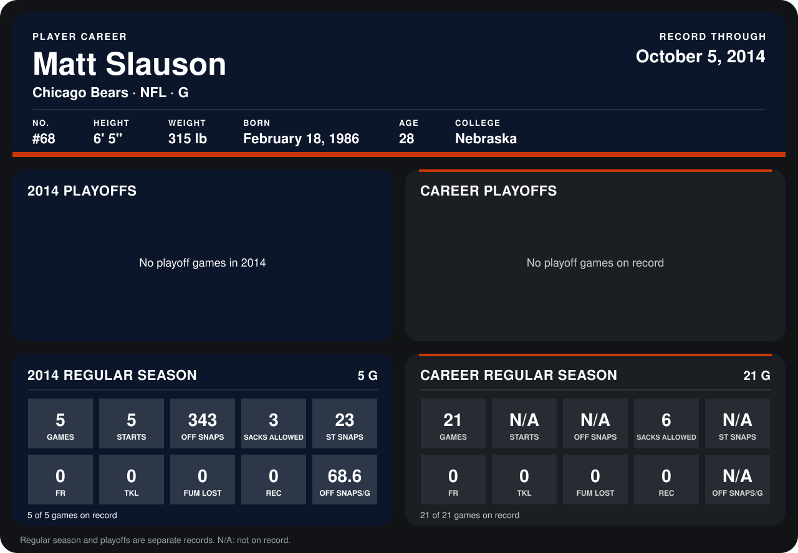

# Matt Slauson

## Career stats

### Regular season

| Season | Club | G | STARTS | OFF SNAPS | SACKS ALLOWED | ST SNAPS | FR | TKL | FUM LOST | REC | OFF SNAPS/G |
|---|---|---:|---:|---:|---:|---:|---:|---:|---:|---:|---:|
| 2013 | Chicago Bears | 16 | N/A | N/A | 3 | N/A | 0 | 0 | 0 | 0 | N/A |
| 2014 | Chicago Bears | 5 | 5 | 343 | 3 | 23 | 0 | 0 | 0 | 0 | 68.6 |
| **Career** |  | 21 | N/A | N/A | 6 | N/A | 0 | 0 | 0 | 0 | N/A |

### Playoffs

No playoff games on record.

## Awards

None on record.

Records through October 5, 2014. Identity: listed 2014 roster data, Weeks 1-4; number: 2014 Week 1 roster. [All Chicago Bears players](README.md).
