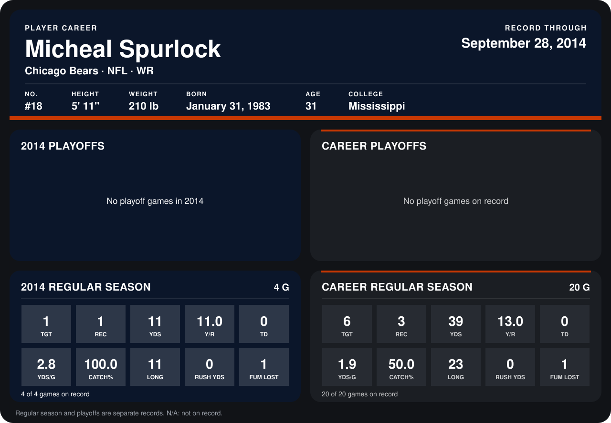

# Micheal Spurlock

## Career stats

### Regular season

| Season | Club | G | TGT | REC | YDS | Y/R | TD | YDS/G | CATCH% | LONG | RUSH YDS | FUM LOST |
|---|---|---:|---:|---:|---:|---:|---:|---:|---:|---:|---:|---:|
| 2013 | Detroit Lions | 16 | 5 | 2 | 28 | 14.0 | 0 | 1.8 | 40.0 | 23 | 0 | 0 |
| 2014 | Chicago Bears | 4 | 1 | 1 | 11 | 11.0 | 0 | 2.8 | 100.0 | 11 | 0 | 1 |
| **Career** |  | 20 | 6 | 3 | 39 | 13.0 | 0 | 1.9 | 50.0 | 23 | 0 | 1 |

### Playoffs

No playoff games on record.

## Awards

None on record.

Records through September 29, 2014. Identity: listed 2014 roster data, Weeks 1-4; number: 2014 Week 1 roster. [All Chicago Bears players](README.md).
