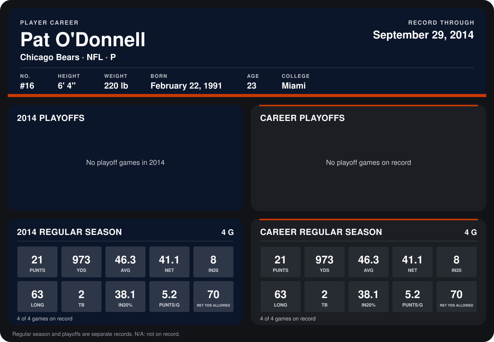

# Pat O'Donnell

## Career stats

### Regular season

| Season | Team | Age | # | G | PUNTS | YDS | AVG | NET | IN20 | LONG | TB | IN20% | PUNTS/G | RET YDS ALLOWED |
|---|---|---:|---:|---:|---:|---:|---:|---:|---:|---:|---:|---:|---:|---:|
| 2014 | Chicago Bears | 23 | 16 | 4 | 21 | 973 | 46.3 | 41.1 | 8 | 63 | 2 | 38.1 | 5.2 | 70 |
| **Career** |  |  |  | 4 | 21 | 973 | 46.3 | 41.1 | 8 | 63 | 2 | 38.1 | 5.2 | 70 |

### Playoffs

No playoff games on record.

## Awards

None on record.

Age is his age on the league's opening game of each season; # is the number listed for him that season with that team (2014: the card's rule; 2013: the 2013 season roster), N/A where no listing applies.

Records through September 28, 2014. Identity: listed 2014 roster data, Weeks 1-4; number: 2014 Week 1 roster. [All Chicago Bears players](README.md).
