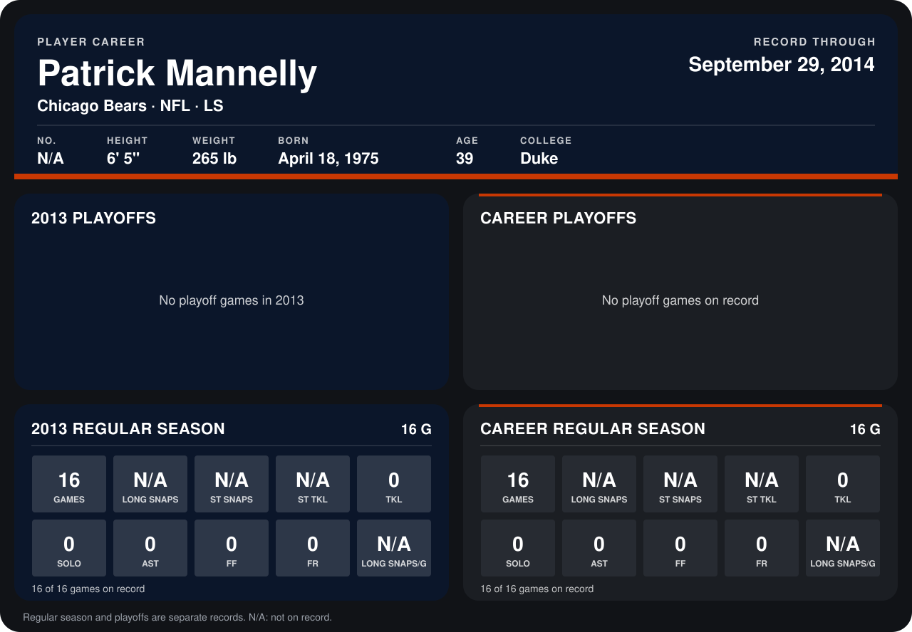

# Patrick Mannelly

## Career stats

### Regular season

| Season | Club | G | LONG SNAPS | ST SNAPS | ST TKL | TKL | SOLO | AST | FF | FR | LONG SNAPS/G |
|---|---|---:|---:|---:|---:|---:|---:|---:|---:|---:|---:|
| 2013 | Chicago Bears | 16 | N/A | N/A | N/A | 0 | 0 | 0 | 0 | 0 | N/A |
| **Career** |  | 16 | N/A | N/A | N/A | 0 | 0 | 0 | 0 | 0 | N/A |

### Playoffs

No playoff games on record.

## Awards

None on record.

Records through September 29, 2014. Identity: the public player file's latest listing (no 2014 Weeks 1-4 roster row). [All Chicago Bears players](README.md).
