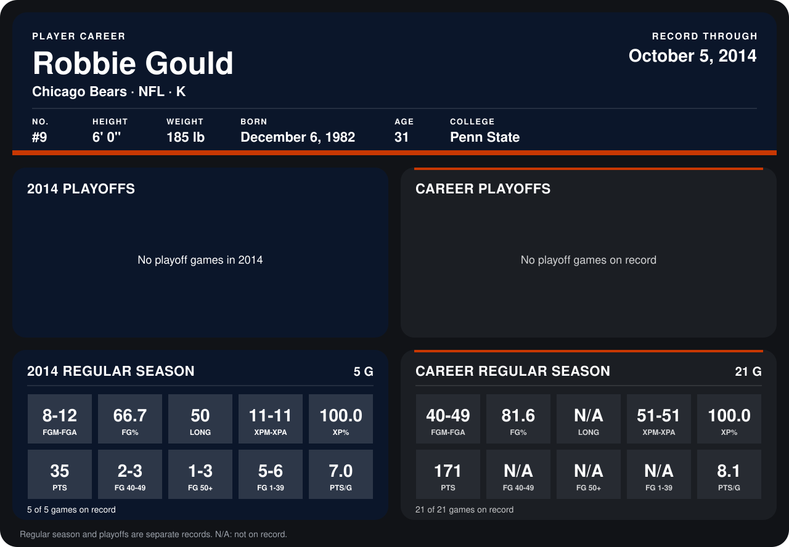

# Robbie Gould

## Career stats

### Regular season

| Season | Club | G | FGM-FGA | FG% | LONG | XPM-XPA | XP% | PTS | FG 40-49 | FG 50+ | FG 1-39 | PTS/G |
|---|---|---:|---:|---:|---:|---:|---:|---:|---:|---:|---:|---:|
| 2013 | Chicago Bears | 16 | 32-37 | 86.5 | N/A | 40-40 | 100.0 | 136 | N/A | N/A | N/A | 8.5 |
| 2014 | Chicago Bears | 4 | 6-10 | 60.0 | 40 | 9-9 | 100.0 | 27 | 1-2 | 0-2 | 5-6 | 6.8 |
| **Career** |  | 20 | 38-47 | 80.9 | N/A | 49-49 | 100.0 | 163 | N/A | N/A | N/A | 8.2 |

### Playoffs

No playoff games on record.

## Awards

- NFC Special Teams Player of the Week (2013, Week 4)
- NFC Special Teams Player of the Week (2013, Week 6)

Records through September 28, 2014. Identity: listed 2014 roster data, Weeks 1-4; number: 2014 Week 1 roster. [All Chicago Bears players](README.md).
