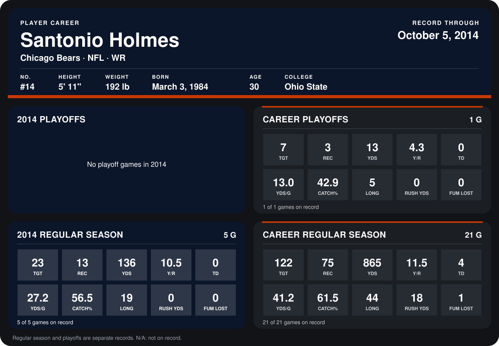

# Santonio Holmes

## Career stats

### Regular season

| Season | Club | G | TGT | REC | YDS | Y/R | TD | YDS/G | CATCH% | LONG | RUSH YDS | FUM LOST |
|---|---|---:|---:|---:|---:|---:|---:|---:|---:|---:|---:|---:|
| 2013 | New York Jets | 16 | 99 | 62 | 729 | 11.8 | 4 | 45.6 | 62.6 | 44 | 18 | 1 |
| 2014 | Chicago Bears | 5 | 23 | 13 | 136 | 10.5 | 0 | 27.2 | 56.5 | 19 | 0 | 0 |
| **Career** |  | 21 | 122 | 75 | 865 | 11.5 | 4 | 41.2 | 61.5 | 44 | 18 | 1 |

### Playoffs

| Season | Club | G | TGT | REC | YDS | Y/R | TD | YDS/G | CATCH% | LONG | RUSH YDS | FUM LOST |
|---|---|---:|---:|---:|---:|---:|---:|---:|---:|---:|---:|---:|
| 2013 | New York Jets | 1 | 7 | 3 | 13 | 4.3 | 0 | 13.0 | 42.9 | 5 | 0 | 0 |
| **Career** |  | 1 | 7 | 3 | 13 | 4.3 | 0 | 13.0 | 42.9 | 5 | 0 | 0 |

## Awards

None on record.

Records through October 5, 2014. Identity: listed 2014 roster data, Weeks 1-4; number: 2014 Week 1 roster. [All Chicago Bears players](README.md).
