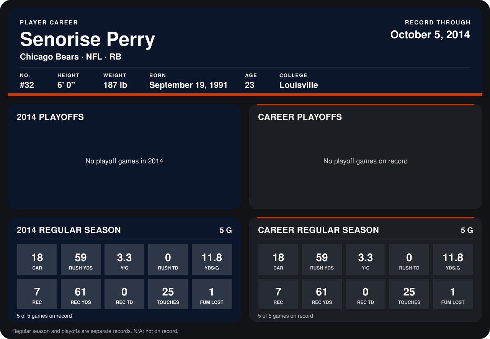

# Senorise Perry

## Career stats

### Regular season

| Season | Team | Age | # | G | CAR | RUSH YDS | Y/C | RUSH TD | YDS/G | REC | REC YDS | REC TD | TOUCHES | FUM LOST |
|---|---|---:|---:|---:|---:|---:|---:|---:|---:|---:|---:|---:|---:|---:|
| 2014 | Chicago Bears | 22 | 32 | 5 | 18 | 59 | 3.3 | 0 | 11.8 | 7 | 61 | 0 | 25 | 1 |
| **Career** |  |  |  | 5 | 18 | 59 | 3.3 | 0 | 11.8 | 7 | 61 | 0 | 25 | 1 |

### Playoffs

No playoff games on record.

## Awards

None on record.

Age is his age on the league's opening game of each season; # is the number listed for him that season with that team (2014: the card's rule; 2013: the 2013 season roster), N/A where no listing applies.

Records through October 5, 2014. Identity: listed 2014 roster data, Weeks 1-4; number: 2014 Week 1 roster. [All Chicago Bears players](README.md).
