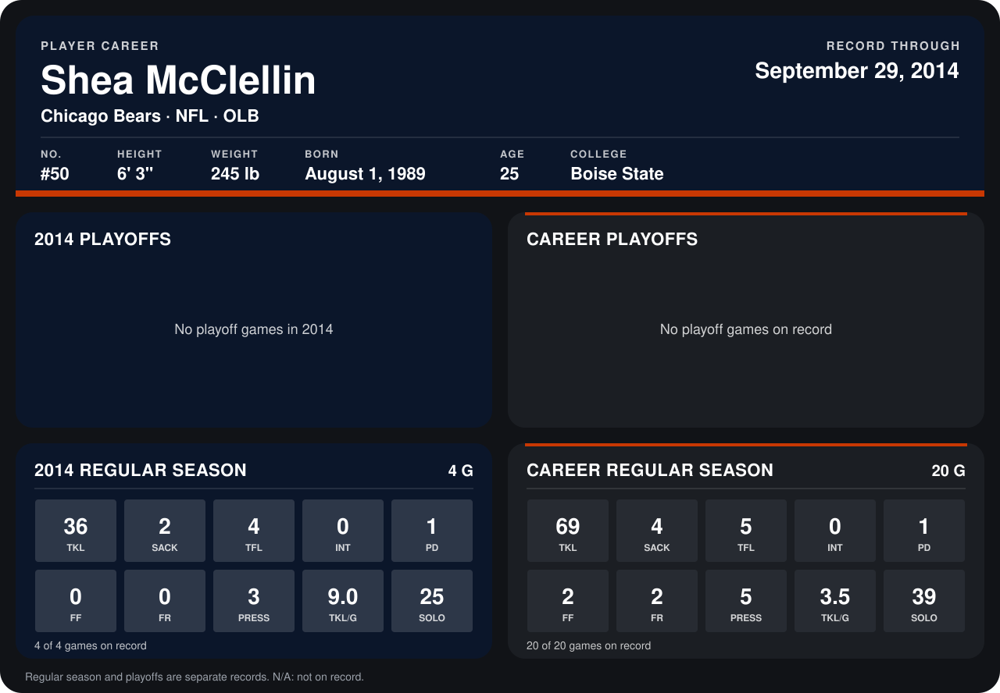

# Shea McClellin

## Career stats

### Regular season

| Season | Club | G | TKL | SACK | TFL | INT | PD | FF | FR | PRESS | TKL/G | SOLO |
|---|---|---:|---:|---:|---:|---:|---:|---:|---:|---:|---:|---:|
| 2013 | Chicago Bears | 16 | 33 | 2 | 1 | 0 | 0 | 2 | 2 | 2 | 2.1 | 14 |
| 2014 | Chicago Bears | 4 | 36 | 2 | 4 | 0 | 1 | 0 | 0 | 3 | 9.0 | 25 |
| **Career** |  | 20 | 69 | 4 | 5 | 0 | 1 | 2 | 2 | 5 | 3.5 | 39 |

### Playoffs

No playoff games on record.

## Awards

None on record.

Records through September 28, 2014. Identity: listed 2014 roster data, Weeks 1-4; number: 2014 Week 1 roster. [All Chicago Bears players](README.md).
