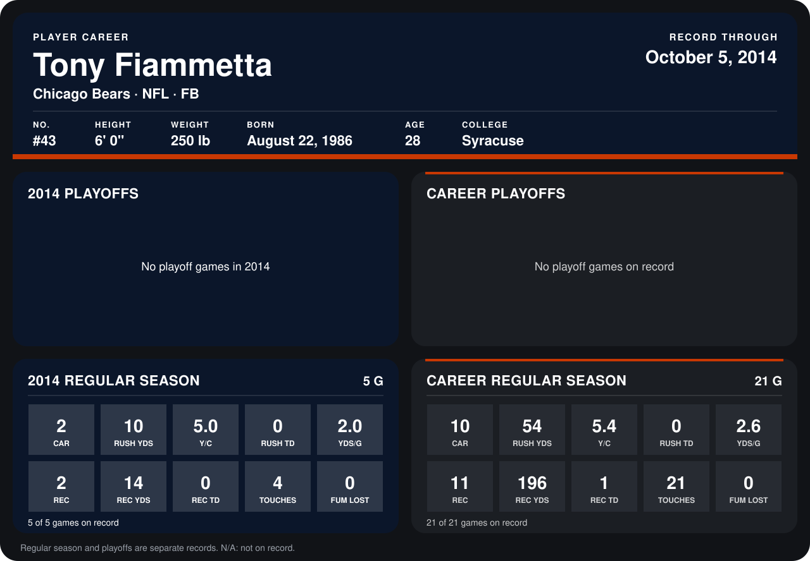

# Tony Fiammetta

## Career stats

### Regular season

| Season | Club | G | CAR | RUSH YDS | Y/C | RUSH TD | YDS/G | REC | REC YDS | REC TD | TOUCHES | FUM LOST |
|---|---|---:|---:|---:|---:|---:|---:|---:|---:|---:|---:|---:|
| 2013 | Chicago Bears | 16 | 8 | 44 | 5.5 | 0 | 2.8 | 9 | 182 | 1 | 17 | 0 |
| 2014 | Chicago Bears | 4 | 1 | 4 | 4.0 | 0 | 1.0 | 0 | 0 | 0 | 1 | 0 |
| **Career** |  | 20 | 9 | 48 | 5.3 | 0 | 2.4 | 9 | 182 | 1 | 18 | 0 |

### Playoffs

No playoff games on record.

## Awards

- AP First-Team All-Pro (2013, FB)
- Pro Bowl selection, replacement (2013, FB)

Records through September 28, 2014. Identity: listed 2014 roster data, Weeks 1-4; number: 2014 Week 1 roster. [All Chicago Bears players](README.md).
