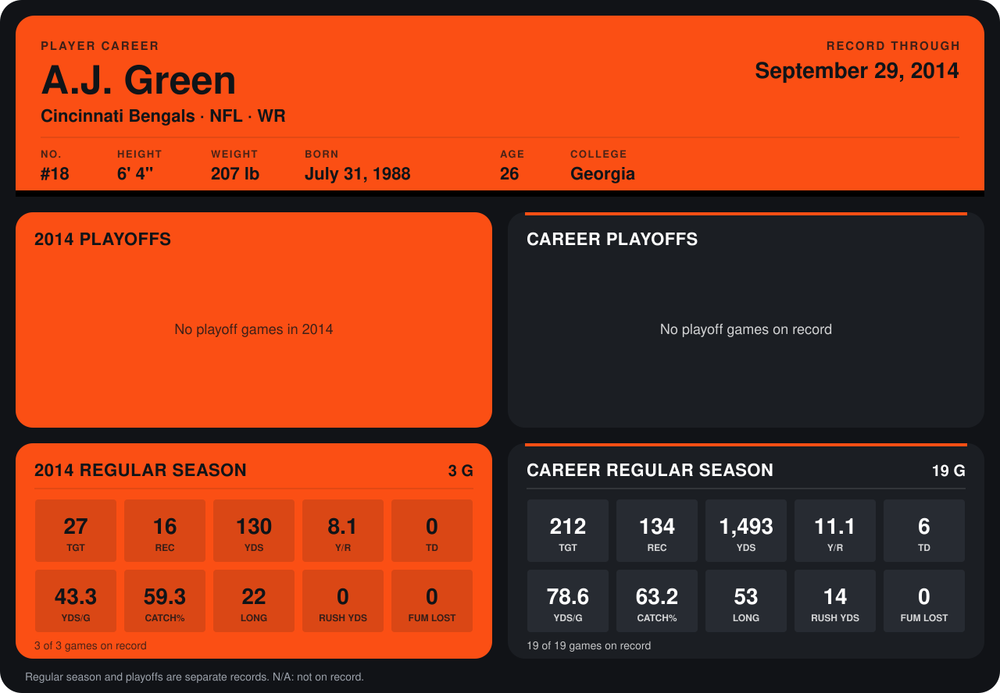

# A.J. Green

## Career stats

### Regular season

| Season | Team | Age | # | G | TGT | REC | YDS | Y/R | TD | YDS/G | CATCH% | LONG | RUSH YDS | FUM LOST |
|---|---|---:|---:|---:|---:|---:|---:|---:|---:|---:|---:|---:|---:|---:|
| 2013 | Cincinnati Bengals | 25 | 18 | 16 | 185 | 118 | 1,363 | 11.6 | 6 | 85.2 | 63.8 | 53 | 14 | 0 |
| 2014 | Cincinnati Bengals | 26 | 18 | 4 | 37 | 23 | 207 | 9.0 | 0 | 51.8 | 62.2 | 26 | 0 | 0 |
| **Career** |  |  |  | 20 | 222 | 141 | 1,570 | 11.1 | 6 | 78.5 | 63.5 | 53 | 14 | 0 |

### Playoffs

No playoff games on record.

## Awards

None on record.

Age is his age on the league's opening game of each season; # is the number listed for him that season with that team (2014: the card's rule; 2013: the 2013 season roster), N/A where no listing applies.

Records through October 5, 2014. Identity: listed 2014 roster data, Weeks 1-4; number: 2014 Week 1 roster. [All Cincinnati Bengals players](README.md).
