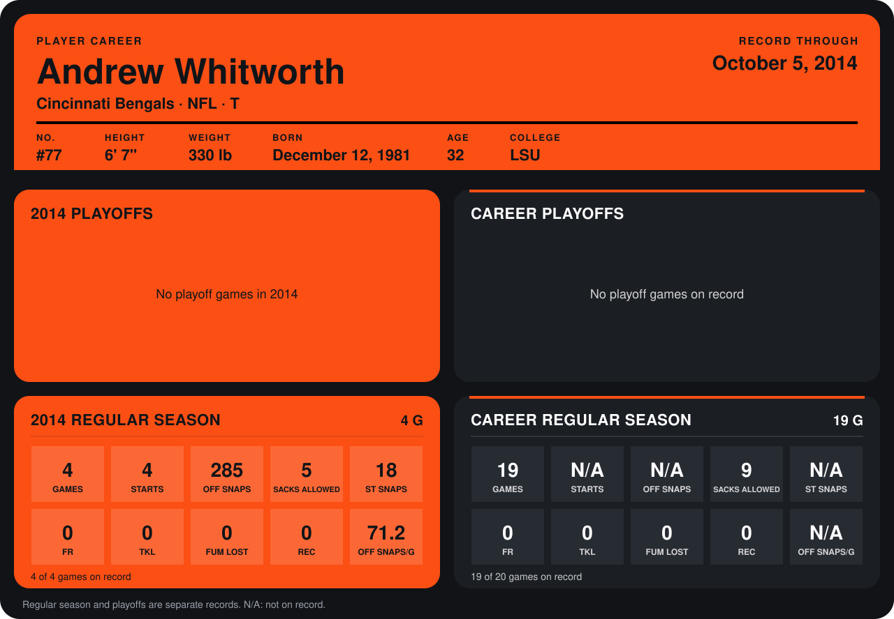

# Andrew Whitworth

## Career stats

### Regular season

| Season | Club | G | STARTS | OFF SNAPS | SACKS ALLOWED | ST SNAPS | FR | TKL | FUM LOST | REC | OFF SNAPS/G |
|---|---|---:|---:|---:|---:|---:|---:|---:|---:|---:|---:|
| 2013 | Cincinnati Bengals | 15 | N/A | N/A | 4 | N/A | 0 | 0 | 0 | 0 | N/A |
| 2014 | Cincinnati Bengals | 3 | 3 | 212 | 4 | 17 | 0 | 0 | 0 | 0 | 70.7 |
| **Career** |  | 18 | N/A | N/A | 8 | N/A | 0 | 0 | 0 | 0 | N/A |

### Playoffs

No playoff games on record.

## Awards

None on record.

Records through September 21, 2014. Identity: listed 2014 roster data, Weeks 1-4; number: 2014 Week 1 roster. [All Cincinnati Bengals players](README.md).
