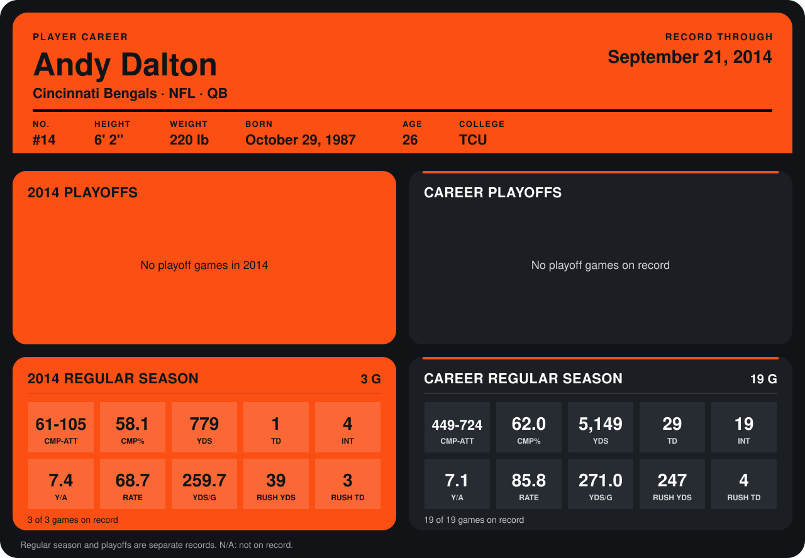

# Andy Dalton

## Career stats

### Regular season

| Season | Team | Age | # | G | CMP-ATT | CMP% | YDS | TD | INT | Y/A | RATE | YDS/G | RUSH YDS | RUSH TD |
|---|---|---:|---:|---:|---:|---:|---:|---:|---:|---:|---:|---:|---:|---:|
| 2013 | Cincinnati Bengals | 25 | 14 | 16 | 388-619 | 62.7 | 4,370 | 28 | 15 | 7.1 | 88.7 | 273.1 | 208 | 1 |
| 2014 | Cincinnati Bengals | 26 | 14 | 4 | 87-149 | 58.4 | 1,046 | 2 | 6 | 7.0 | 67.7 | 261.5 | 39 | 3 |
| **Career** |  |  |  | 20 | 475-768 | 61.8 | 5,416 | 30 | 21 | 7.1 | 84.6 | 270.8 | 247 | 4 |

### Playoffs

No playoff games on record.

## Awards

- AFC Offensive Player of the Week (2013, Week 13)
- AFC Offensive Player of the Week (2013, Week 16)
- AP Second-Team All-Pro (2013, QB)
- Pro Bowl selection (2013, QB)

Age is his age on the league's opening game of each season; # is the number listed for him that season with that team (2014: the card's rule; 2013: the 2013 season roster), N/A where no listing applies.

Records through October 5, 2014. Identity: listed 2014 roster data, Weeks 1-4; number: 2014 Week 1 roster. [All Cincinnati Bengals players](README.md).
