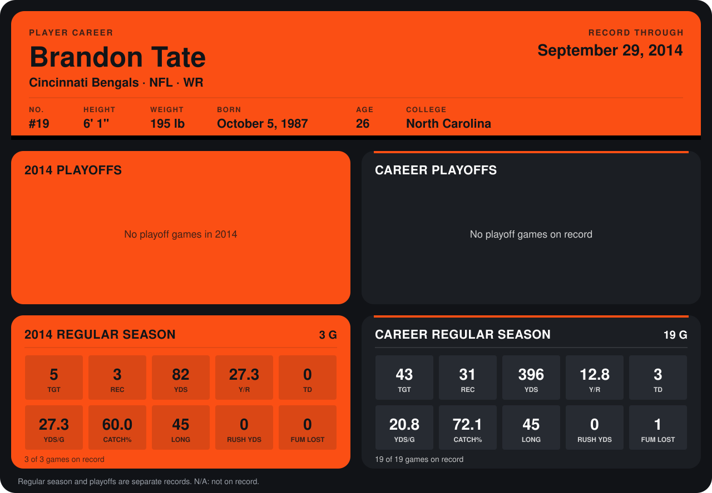

# Brandon Tate

## Career stats

### Regular season

| Season | Team | Age | # | G | TGT | REC | YDS | Y/R | TD | YDS/G | CATCH% | LONG | RUSH YDS | FUM LOST |
|---|---|---:|---:|---:|---:|---:|---:|---:|---:|---:|---:|---:|---:|---:|
| 2013 | Cincinnati Bengals | 25 | 19 | 16 | 38 | 28 | 314 | 11.2 | 3 | 19.6 | 73.7 | 38 | 0 | 1 |
| 2014 | Cincinnati Bengals | 26 | 19 | 3 | 5 | 3 | 82 | 27.3 | 0 | 27.3 | 60.0 | 45 | 0 | 0 |
| **Career** |  |  |  | 19 | 43 | 31 | 396 | 12.8 | 3 | 20.8 | 72.1 | 45 | 0 | 1 |

### Playoffs

No playoff games on record.

## Awards

None on record.

Age is his age on the league's opening game of each season; # is the number listed for him that season with that team (2014: the card's rule; 2013: the 2013 season roster), N/A where no listing applies.

Records through September 21, 2014. Identity: listed 2014 roster data, Weeks 1-4; number: 2014 Week 1 roster. [All Cincinnati Bengals players](README.md).
