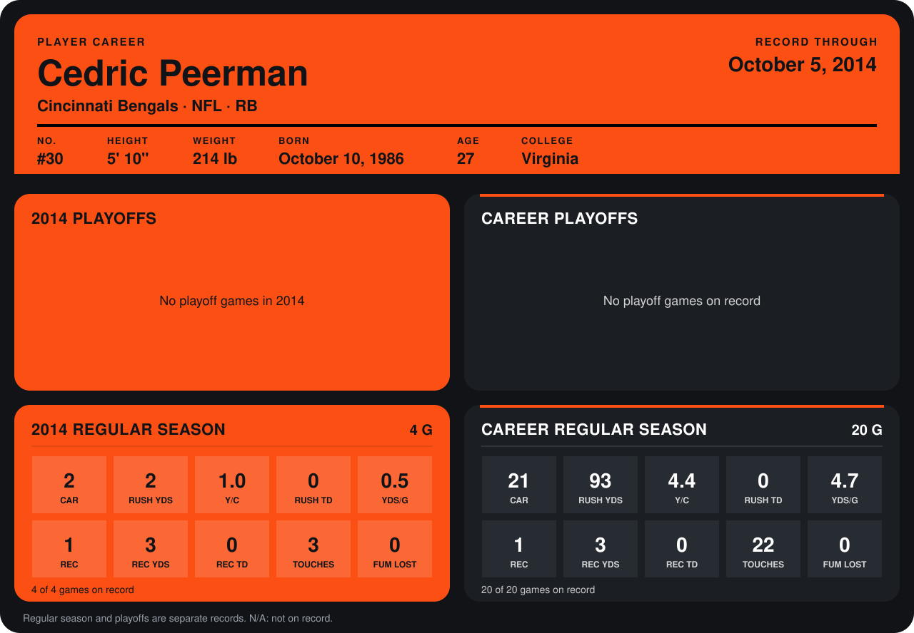

# Cedric Peerman

## Career stats

### Regular season

| Season | Club | G | CAR | RUSH YDS | Y/C | RUSH TD | YDS/G | REC | REC YDS | REC TD | TOUCHES | FUM LOST |
|---|---|---:|---:|---:|---:|---:|---:|---:|---:|---:|---:|---:|
| 2013 | Cincinnati Bengals | 16 | 19 | 91 | 4.8 | 0 | 5.7 | 0 | 0 | 0 | 19 | 0 |
| 2014 | Cincinnati Bengals | 3 | 1 | 1 | 1.0 | 0 | 0.3 | 1 | 3 | 0 | 2 | 0 |
| **Career** |  | 19 | 20 | 92 | 4.6 | 0 | 4.8 | 1 | 3 | 0 | 21 | 0 |

### Playoffs

No playoff games on record.

## Awards

None on record.

Records through September 21, 2014. Identity: listed 2014 roster data, Weeks 1-4; number: 2014 Week 1 roster. [All Cincinnati Bengals players](README.md).
